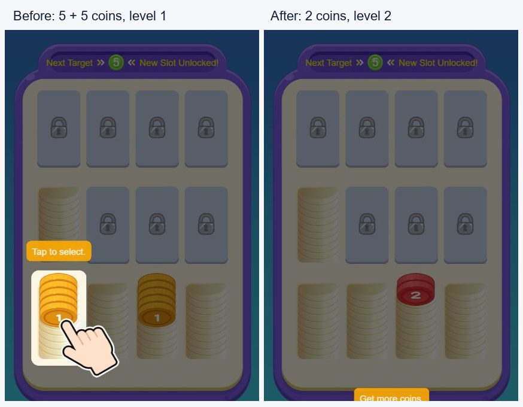

# Tidy Coins 3D：Godot 复刻规格与 REA 证据

版本：2026-10-19；目标项目：`D:\projects\coin-merge`。本文记录当前已捕获发布版的玩法、配置与实现细节，供复刻开发使用。规则正文、完整配置、代码快照、运行验证和未知项共同构成这份交付。

**最关键的规则：普通模式每槽最多 10 枚，点击搬运顶部连续同级币，10 枚同级且已揭示的币自动变成 2 枚高一级币；挑战模式沿用搬运，但目标是填满指定颜色槽，并额外支持整摞异色交换。**

## 1. 分析对象、可信度与阅读约定

### 1.1 发布版身份

| 项目 | 已知值 |
|---|---|
| 游戏 | Tidy Coins 3D / 整洁的硬币 3D |
| 页面所示工作室 | Pupu Games Studio |
| 用户提供入口 | [YouTube Playables](https://www.youtube.com/playables/UgkxP0bGugMKLTPTbHIMdt6iuUI4QgKUDmek) |
| 真实游戏页 | `https://8388451114541855247.playables.usercontent.goog/v/assets/index.html` |
| 核心发布脚本 | `https://8388451114541855247.playables.usercontent.goog/v/assets/assets/main/index.js` |
| 脚本大小 | 241,317 字节 |
| SHA-256 | `36dbde0e3c574aa866b28a0724fd6858b4aba84ddcd62504855bbfeabe6b7599` |
| 运行中观察到的引擎 | Cocos Creator 2.4.13，场景 `main` |
| HTML GAME_VERSION | `1.0.0.260719_1811_50b68c2` |
| 设置界面代码显示版本 | `2.0.5-yt`；与 HTML 构建号属于不同字段 |
| 分析工具 | REA 6.7.0；补充浏览器 UI 操作及只读 CDP 状态读取 |

### 1.2 证据分级

- **[运行验证]**：已实际操作普通模式教程的选择、转移、合并和固定发牌；还实际观察过容量不足时的部分搬运。教程合并结果已读取到两枚 `num=2, unknown=false`。
- **[代码确认]**：直接核对捕获的发布脚本。后续普通关卡、失败救援、奖励广告结果处理、挑战生成与胜利等属于这一类，尚未逐项实玩。
- **[配置确认]**：真实捕获的发布 JSON 表，包括完整 100 关挑战目标布局。
- **[复刻建议]**：面向 Godot 的组织和实现方案，不代表原作采用相同结构。
- **[待验证]**：现有证据不足，不能当成原作事实。

正文未特别标记的精确算法来自代码/配置确认。这里的“全部已知信息”指本次捕获范围内已建立的结论，不表示已遍历所有线上内容。REA 捕获达到 300 events / 100 transactions 的预算，网络覆盖不完整；静态图达到每文件 20,000 nodes 上限，语义图覆盖不完整。关键规则另外对照了原始函数和配置。

### 1.3 数组与坐标约定

所有硬币数组统一写作 **槽底 → 可操作顶部**，末尾元素是顶部。例如 `[1,1,2,2,2]` 只能选中末尾三枚 2。`[n,true]` 表示真实等级为 n、外观尚未揭示；普通整数 n 表示已知币。这里的“等级”对应代码 `num`，不是可按面值守恒的金额。

这里的“槽底/顶部”是逻辑顺序。二维画面中，索引增加时硬币向屏幕下方排列，后面的币遮挡前面的币；不要据术语把可操作币摆到屏幕上方。

逻辑槽编号取 `_allItems`，普通槽列表另有 `_normalItems`。Cocos 在初始化与选中时会改变节点 siblingIndex；不要用当前显示子节点顺序代替逻辑槽编号。

## 2. 游戏整体结构与循环

### 2.1 普通模式

循环为：**选顶部同级段 → 移到空槽或相同顶级槽 → 满 10 自动升级 → 发牌补币继续整理 → 达到阶段目标开放槽位 → 完成第五目标进入下一大关**。盘面堵满时可救援整理或重试。

普通模式是持续生成新币的空间整理游戏。玩家没有步数上限和倒计时；失败判定来自盘面空间状态。发牌会同时进入多个槽，可能制造混色和隐藏段。阶段目标展示在上方进度条，当前目标也显示在盘面上方。

### 2.2 挑战模式（代码前缀 War）

循环为：**生成固定目标布局和随机混色盘 → 搬运顶部同色段或交换整摞异色币 → 每个目标槽装满指定颜色并打勾 → 全目标完成 → 记录耗时与首次奖励**。

挑战不是普通模式换一个皮肤：它没有“10 变 2”的消耗升级，也没有普通模式持续发牌。其颜色库存由目标布局决定，计时为已用时间累加。

### 2.3 页面及可见功能

| 页面/模块 | 行为 |
|---|---|
| 启动/加载 | 工作室 Logo、资源和存档加载；新用户可直接进入普通教程 |
| 主菜单 MainUI | 进入普通模式、挑战选关、设置 |
| 普通游戏 GameUI | 12 槽棋盘、阶段目标、发牌、设置（局内返回入口）、自动合并表现 |
| 普通失败 LevelFailUI | 剩余整理次数、奖励广告标识、整理续命、重试 |
| 挑战选关 WarUI | 分页关卡，锁定/可玩/进行中/完成/等待状态 |
| 挑战游戏 WarGameUI | 目标颜色、完成数/总目标数、耗时、设置/退出 |
| 挑战完成/记录 | 最佳耗时、继续下一关或返回 |
| 设置/语言 | 音频开关、支持设备上的振动开关、语言、局内重开/返回 |

`MainUI` 的 rank 与 collection/egg 入口显式关闭，对应点击函数为空。工程里有排行榜、收集动画及皮肤/彩蛋表，但现有入口不能证明它们构成可用玩法。主游戏普通 merge 按钮隐藏；常规操作依赖自动合并。

## 3. 逻辑数据模型

### 3.1 硬币与槽

```text
Coin:
    num: integer           # 普通模式等级 / 挑战颜色编号
    isUnknown: boolean     # 真实值始终存在，隐藏只影响显示与选中段边界

Cell:
    state: CellState
    ownCoins: Coin[]       # 底 → 顶；最多 10
    awaitCoins: Coin[]     # 当前选中的顶部段，运行态
    animating: boolean
    targetNum?: integer   # 仅挑战目标色；中性槽无正目标
    tick?: boolean        # 仅挑战完成显示；可从盘面重算
```

容量由 `GameConst.COIN_PUT_MAX_NUM=10` 硬编码，配置也有 `mergeNeedNum=10`。普通模式预创建 12 槽；开局默认 5 槽可用，其余锁定/待解锁/奖励槽。

| 状态 | 数值 | 发布代码用途 |
|---|---:|---|
| Normal | 0 | 正常显示和操作 |
| Lock | 1 | 未解锁，点击播锁反馈 |
| Unlockable | 2 | 已获得解锁资格，点击播解锁，再加入可用槽列表 |
| CanUsingAd | 3 | 请求奖励广告的槽 |
| UsingAd | 4 | 遗留或特定教学数据可用态；不要统一当成计时租用 |
| LockAd | 5 | 遗留广告锁定外观；新版普通存档有迁移 |

普通槽存档是 `[state, coinArray]`，例如 `[0,[1,1,[2,true],3]]`。挑战槽运行时初始化可用 `[state,targetNum,coinArray]`，但 dump 仍只有 `[state,coinArray]`，恢复时从本关目标配置重新补回 targetNum。

### 3.2 全局存档字段与默认值

| 字段 | 默认 | 含义 |
|---|---|---|
| NormalLevel | 1 | 普通大关 L |
| UnlockCellNum | 5 | 普通阶段推进用的槽位解锁计数；不等于实时可操作槽数 |
| NormalLevelData | null | 普通盘面快照 |
| NormalBoardVersion | 0 | 新版棋盘存档版本，现逻辑写 2 |
| CoinLevel | 1 | 历史达到的最高等级，用于分数与挑战解锁 |
| ShuffleLeft | 3 | 当前大关剩余救援整理次数；null 时重置 3 |
| WarLevel | 1 | 当前/下一挑战关卡进度字段 |
| WarMaxLevel | 1 | 选关中第一个未满足解锁条件的边界，不能直接当已完成最大关 |
| WarTime | 0 | 挑战当前已用时间，单位秒 |
| WarLevelData | null | 挑战盘面快照 |
| WarBestTimes | `{}` | 关卡号→最佳秒数 |
| WarStartTime | 0 | 挑战入口间隔判断时间戳，毫秒 |
| GoldNum | 0 | 挑战首次完成加 1；未证实存在可用消费循环 |
| AdTimes | 0 | 遗留/统计字段，不能据此推出广告计数玩法 |

设置 AudioEnable 与 VibrateEnable 均默认 true。`_curTargetIndex`、选中源、自动合并等待标记、输入锁等属于运行态，不直接持久化。

## 4. 选择、搬运与点击状态机

### 4.1 选中规则

空闲时点击正常非空槽：若槽正在合并动画中则拒绝；否则取末尾一枚，再向前扫描同 `num` 且非隐藏的连续硬币，遇到不同等级或隐藏币停止。全部选中币上抬并播放选择动画。

例：`[1,2,2,3,3,3]` 选三枚 3；`[1,2,[2,true],2,2]` 只选末尾两枚 2。不能直接点选底层币，不能一次选中多个不同等级。

精确边界：原函数先无条件加入最顶币，再对其下方执行非隐藏检查，**没有单独拒绝“最顶币为隐藏”**。正常生成/揭示流程应保持顶币可见；若做异常盘面测试，应保留这个已知代码行为，不能声称发布版存在完整顶币隐藏防护。

### 4.2 有选中源时点击目标

1. 点同一槽：全部取消，恢复原位。
2. 点 Lock：播锁反馈；这条路径没有清空此前源选择。
3. 点 Unlockable：开始解锁；这条路径也不属于普通搬运。
4. 点奖励槽：进入奖励请求；原作没有先统一取消选择。
5. 点另一正常槽：目标有空位，且为空或其顶币 num 与选中币相同，才允许移动。
6. 移动数量为 `min(选中数量,10-目标数量)`，允许只移动部分。
7. 目标满或顶级不同：选中币抖动、警告音、清除选择。

例：源 `[1,2,2,2,2]`，目标 `[3,3,2,2,2,2,2,2,2]`，目标只剩 1 位；移动后源 `[1,2,2,2]`，目标 `[3,3,2,2,2,2,2,2,2,2]`。目标虽然满 10，但有 3，不能合并。

原作输入绑定 `TOUCH_START`，是 **点击源再点目标**，无需拖拽轨迹或松手落点。全局禁用多点触摸。若增加拖拽，属于复刻扩展，不能替代原有点击路径。

### 4.3 数组更新与输入锁

`source.removeCoins(k)` 从末端 splice，不重新排序；返回的片段按原顺序追加到目标。物理运动只是显示插值，规则在数组中处理。搬运期间 `addForcewait` 屏蔽 UI，最后一个币回调后重新检查规则、标记存档、释放锁。

选中数组内部是顶→下的引用扫描顺序，但实际搬运片段来自 `ownCoins` 尾切片；实现时不要把选中数组直接反转拼入目标，导致混合数据次序变化。

```text
try_move(source, target):
    if target is not a normal playable cell: use its state-specific action
    if source == target: cancel_selection(); return
    free = 10 - target.size
    if free <= 0 or (target not empty and target.top.num != selected.num):
        warn_and_cancel(); return
    k = min(selected.count, free)
    moved = source.remove_tail(k)
    reveal_exposed_hidden_segment(source)
    target.append_in_original_order(moved)
    cancel_remaining_selection()
    animate_move_under_input_lock()
    on_complete: refresh_rules(); save_board(); unlock_input()
```

### 4.4 隐藏币揭示

源移走后若还非空，且新顶部为隐藏：立即将其逻辑标记置为已知，向下揭示整个连续隐藏段，直到遇到可见币或槽底。**此循环不检查相邻隐藏币 num 是否相同。** 翻面以缩小/放大切换贴图实现，普通模式额外播光效。隐藏币不会被删除，也不会在揭示时重新随机。

隐藏段边界显示问号标记；问号是表现节点，不是额外的币或独立等级。目标允许判定只看真实顶级，未额外检测 top.isUnknown，仍依赖“可操作顶部可见”的正常流程约束。

## 5. 普通合并与自动调度

### 5.1 唯一合并条件和结果

满足三项才合并：槽数量 **恰好** 10、所有币 num 相同、所有币已揭示。

```text
can_merge(cell) = size == 10 and all_same_num and all_known
merge([n,n,n,n,n,n,n,n,n,n]) = [n+1,n+1]
```

原函数 `splice(0,8)` 回收底部 8 枚，留下顶部 2 枚，对二者各执行 `num+1`。每次释放 8 个容量。不是 10 合 1，不是数字乘 2，也不是按硬币金额守恒计算。挑战模式不调用这一合并过程。

### 5.2 调度顺序

- 搬运结束、发牌结束、整理结束、合并结束后调用 `_freshBtnStates`。
- 扫描 `_normalItems`，可合并槽放 `_canMergeItems`；其他有空位槽放 `_canDealItems`。
- 有可合并槽且无现存自动任务：设置 `_autoMerging=true`，0.5 秒后触发 `onMerge`。
- `onMerge` 取消当前选择，锁输入，同批启动所有就绪槽的合并。
- 多于一槽则计划 0.35 秒后播放 combo；代码捕获的计数同时被合并完成回调递减，正常时序下 combo 在槽回调之前执行。不要把 combo 理解为额外币奖励。
- 以本批合并前最高 topCoinLv 的 `+1`，在 0.8 秒后调用 `checkUpgrade`。
- 各槽结束后重新扫描、保存、解锁。

没有跨槽自动搬运、相邻槽合并或寻路式连锁。多槽同时满足条件才形成批量 combo。0.5 秒等待阶段不是整个棋盘一直锁住；真正动作执行期间才加输入锁。

### 5.3 合并时序

底部 8 枚按 `0.25/8=0.03125` 秒间隔依次隐藏回收，总过程约 0.25 秒。剩余 2 枚重新定位，光效出现，升级缩放动画为 0.15 秒缩到 0，在切换 num/贴图后 0.15 秒放回 1；币容器另等待 0.4 秒才完成该槽回调。进度检查的 0.8 秒定时与这些视觉回调并行。

## 6. 普通教程：固定数据和步骤

### 6.1 初盘与第一次发牌

配置初盘的前 5 个逻辑槽：

```text
0: [1,1,1,1,1]
1: []
2: [1,1,1,1,1]
3: []
4: []
其余 7 槽：锁定
```

先把槽 0 的 5 枚 1 移入槽 2，形成十枚，教程调用合并得到 `[2,2]`。教程固定发牌向槽 0 加 `[2,2,2]`、槽 1 加 `[2,2,2,2]`、槽 2 加 `[2]`，故发完前三槽分别有 3、4、3 枚 2。教程发牌读取配置并对逐格读出的值 unshift；本表同值，因此不影响结果。



### 6.2 引导状态机

| 内部步骤 | 动作 |
|---:|---|
| 0 | 高亮槽 0，点击选中 |
| 1 | 高亮槽 2，点击移入 |
| 2 | 调用合并，等待 0.8 秒 |
| 3 | 引导点击发牌 |
| 4 | 选择槽 0 的三枚 2 |
| 5 | 移入槽 1，形成七枚 2 |
| 6 | 选择槽 2 的三枚 2 |
| 7 | 移入槽 1，形成十枚 2 |
| 8 | 再合并，等待 0.8 秒，得到两枚 3 |
| 9 | 介绍最终目标，遮罩全屏点击继续 |
| 10 | 再次点击发牌，结束引导 |

有手指、镂空遮罩、目标点击区域和提示文字；输入由引导转发给相同的槽点击函数。提示键包括 `guide.tap_select`、`guide.same_type`、`guide.merge_10`、`guide.get_more`、`guide.keep_merge`、`guide.merge_target`，实际状态机并不逐个按顺序显示全部提示键。

引导完成取消 guideFlag，在锁列表末端选一个 Lock 改为 CanUsingAd，写 NormalBoardVersion=2，开启云存档。启动判定不是持久化 guideDone：`NormalLevel==1 && _getMaxNum(普通存档)<=2` 时可再次走教程；此辅助函数主要统计普通数字币，没有统计数组形式隐藏币。

## 7. 普通盘面初始化、进度和槽位解锁

### 7.1 大关与五阶段目标

令大关 `L=NormalLevel`，基数 `B=6*(L-1)+1`。五目标是 `B+[4,5,6,8,9]`：

| 大关 | 基数 | 五阶段目标 |
|---:|---:|---|
| 1 | 1 | 5、6、7、9、10 |
| 2 | 7 | 11、12、13、15、16 |
| 3 | 13 | 17、18、19、21、22 |

合并产生 8 级币不会必然推进目标为 9 的阶段。`checkUpgrade(newLevel)` 先更新历史 CoinLevel、上报平台分数，再比较本关最高值与当前目标；每次调用最多推进 **一个** 阶段，没有 while 逐级追赶。

| 完成目标后进入的索引 | UnlockCellNum 增量 | 额外表现 |
|---:|---:|---|
| 1 | +2，最多到 12 | 进度推进、槽解锁资格 |
| 2 | +2 | 0.5 秒后祝贺弹窗，关闭后插屏请求 |
| 3 | +2 | 进度推进 |
| 4 | +1 | 0.5 秒后祝贺弹窗，关闭后插屏请求 |
| 5 / 大关完成 | 重置为 5 | 清盘、L+1、重置救援次数、存关键进度、烟花/大币、祝贺、插屏、切盘 |

`unlockOneCell` 从 `_lockItems.shift()` 取一槽置 Unlockable，玩家点击并完成解锁动画后才加入 `_normalItems`。因此“获得资格”与“真正可接币”分为两步。奖励槽也可能从锁列表中移除，故阶段计数不能直接等同实时可用数量。

恢复阶段用 `extra=UnlockCellNum-5`：extra≥7→索引4；≥5→3；≥3→2；≥1→1；否则0。正常累积计数是 5→7→9→11→12。初始化还把索引 `[5,UnlockCellNum)` 内仍为 Lock 的存档槽改成 Unlockable。

### 7.2 非教程随机开局的精确过程

有有效 `NormalLevelData` 时优先恢复；没有时走 `_initNormalLv`：

1. 取 5 个槽编号 `[1,2,3,4,5]`，使用 MathTools.shuffle 打乱。
2. 前两个随机位置分别放纯 B 和纯 B+1；各自数量独立均匀取整数 2–5。
3. 剩余三个位置各放四枚 `[v,I,I,I]`。颜色候选初始化为 `[B,B+1,B+2,B+3]`。
4. 每次从候选表随机 splice 出 v，再从剩余表 splice 出 I，两者不同。该候选表跨槽消耗；长度<2 时改用另一个初始相同候选表。不要为每个槽重置候选，也不要改成逐币独立随机。
5. 生成 Map 按编号写回实际 0-based 槽数组。

**已核对的发布版差异：**函数内部确实对 L>1 的后三枚设 `isUn=true`，但最后执行 `d.map(e=>e.num)`，只把数字交给 `_initLv`，隐藏标记被丢弃。因此此发布版新建的非教程初盘最终为可见币；后续四枚发牌生成的隐藏标记则能保留。若希望严格匹配这一构建，不应自行“修复”开局隐藏；该差异尚未在后续大关实玩验证。

### 7.3 普通开局的槽状态构造

先加入上述 5 个 Normal（含币）槽。再加入 `n=min(3,floor(L/2))` 个额外空 Normal。L≥2 且总数<12 时再加一个 Unlockable。之后补足 12：当前索引小于 UnlockCellNum 就加 Unlockable，否则 Lock。非教程初始化最后将最末一个 Lock 改成奖励槽 CanUsingAd；教程初盘不进行这一步。

在刚进入大关、UnlockCellNum=5 的情况下：

| 大关 | 初始 Normal | 初始 Unlockable | 奖励槽 | 其他锁槽 |
|---|---:|---:|---:|---:|
| 1，非教程重开 | 5 | 0 | 1 | 6 |
| 2–3 | 6 | 1 | 1 | 4 |
| 4–5 | 7 | 1 | 1 | 3 |
| ≥6 | 8 | 1 | 1 | 2 |

这正是后续大关不能简单写成“每关固定只开放 5 槽”的原因。重试保留当前 L 与 UnlockCellNum，清盘和 ShuffleLeft，再按这些规则生成；不把 CoinLevel 或解锁阶段清回新用户状态。

### 7.4 奖励槽与遗留存档

普通奖励槽点击后请求 `normalTempItem`。同一层只允许一个请求，期间锁输入；返回后检查层和槽仍有效。只有 `earned` 才移出锁列表，播放开启动画，加入正常可用槽并保存。`not_completed`、`unavailable` 只提示，不发奖。普通槽最终 state=Normal，当前盘没有按秒归还的实现。

NormalBoardVersion<2 的普通盘面迁移：UsingAd→Normal；Lock/LockAd/CanUsingAd 若带币也→Normal；空 LockAd/CanUsingAd→Lock。迁移后写版本2。不能把旧状态名称直接解释成新版“10秒临时槽”；`adsLockCount=10` 配置也不足以证明计时功能。

## 8. 普通发牌：完整随机算法与概率

### 8.1 发到哪些槽

入口为 `CellLayer.onDeal → DealCoin.getDealCoinByCell → getDealCoin`。教程用固定表，不参与本节随机。

1. 遍历正常可用槽，记录剩余容量>0的候选，键是 `_normalItems` 中的索引。满10的槽无候选资格。
2. 遍历这些正常槽内全部币，按发现顺序构建现有 num 的 Map；隐藏币真实 num 也参与。排除当前最大值 M。
3. 最大值由整层所有槽的币计算；L=1 且最大值≤4时，生成器按 M=5 处理。因此最早阶段实际不会排除盘上的 1/2/3/4，而是排除不存在的5。
4. 候选超过1槽时，只删掉其中一个候选。优先在非空槽（剩余容量≠10）里均匀随机选一个删掉；没有非空槽才在全空槽里删。
5. 其余候选都参与本次生成，各槽数量随后按表随机并截断到余量。只有1候选时不跳过。

它不是“只发到一槽”或“把所有槽填满”。有空位的混色槽照样可能接到与顶色不同的新币；发牌不走玩家搬运的顶色匹配判定。

### 8.2 每槽数量权重

当前阶段索引0–4选择 `ExcelgetCoinNum{,1,2,3,4}`。下表每格为 **原始权重 / 归一化概率**；抽到数量后再 `min(剩余容量,计划数量)`，所以实际1枚也可能出现。

| 阶段 | 权重总和 | 2枚 | 3枚 | 4枚 | 5枚 | 6枚 |
|---:|---:|---|---|---|---|---|
| 0 | 125 | 20 / 16% | 20 / 16% | 60 / 48% | 25 / 20% | 0 / 0% |
| 1 | 100 | 10 / 10% | 0 / 0% | 35 / 35% | 30 / 30% | 25 / 25% |
| 2 | 100 | 10 / 10% | 0 / 0% | 10 / 10% | 35 / 35% | 45 / 45% |
| 3 | 100 | 5 / 5% | 5 / 5% | 25 / 25% | 35 / 35% | 30 / 30% |
| 4 | 100 | 5 / 5% | 10 / 10% | 20 / 20% | 35 / 35% | 30 / 30% |

阶段0权重合计125，不是100；不可直接把60写成60%的“四枚概率”。顺序也是原表顺序参与累计抽样，严格重放随机序列时应保留。

### 8.3 每槽使用哪些等级

`getCoinNumbers(候选槽数 K,现有num的Map)`：先依 Map 插入顺序取前 K 种；不足时依次扫描 `[B,M)` 中尚未出现的等级；仍为空则放 B；仍不足就从种子表头部重复追加直到 K 个。结果一槽一个种子，不是随机打散种子分配。

`randNeedNumbers(seed,extraTypes)`：第一个等级固定是 seed，其他等级从 `[B,M)` 除 seed 之外不放回随机抽取。若 M≤B，函数退回重复 seed。通常新发币不包含本盘当前最高等级，新最高级靠合并获得。该函数依赖候选池够用，未看到通用修复/求解器；异常存档下不应擅自声称绝不会产生空值。

### 8.4 成组排列模板（全部五组）

字符串每位表示本批位置使用第几个等级，例如 `112233` 对应 `[A,A,B,B,C,C]`。实际只取本次数量的前 N 位；类型数由源码扫描 `location2..locationN` 求最大索引，再额外抽取所需等级。`type` 是模板编号，不是硬币等级。

| 阶段 | 模板 ID | 权重（每阶段合计100） | location 序列 |
|---:|---:|---:|---|
| 0 | 1 | 50 | `11111` |
| 0 | 2 | 30 | `11222` |
| 0 | 3 | 20 | `11122` |
| 1 | 1 | 30 | `111111` |
| 1 | 2 | 40 | `111122` |
| 1 | 3 | 20 | `112222` |
| 1 | 4 | 10 | `112211` |
| 2 | 1 | 10 | `111111` |
| 2 | 2 | 20 | `111222` |
| 2 | 3 | 40 | `112233` |
| 2 | 4 | 20 | `112211` |
| 2 | 5 | 10 | `112333` |
| 3 | 1 | 5 | `111111` |
| 3 | 2 | 20 | `111222` |
| 3 | 3 | 30 | `112233` |
| 3 | 4 | 25 | `122333` |
| 3 | 5 | 10 | `112211` |
| 3 | 6 | 10 | `122211` |
| 4 | 1 | 5 | `111122` |
| 4 | 2 | 20 | `112233` |
| 4 | 3 | 25 | `122233` |
| 4 | 4 | 15 | `122333` |
| 4 | 5 | 20 | `112311` |
| 4 | 6 | 15 | `123311` |

例如阶段0模板 `11122`、本槽实际4枚，结果是 `[A,A,A,B]`；实际2枚则只有 `[A,A]`，即使模板尾部含第二种币也不会出现。1枚时直接使用种子，跳过模板抽样。

### 8.5 四枚特殊隐藏规则

当 **L>1 且该槽截断后实际发4枚**，代码仍抽模板，但最终覆盖为 `[A?,A?,A?,B]`，问号表示前三枚 hidden、第四枚可见，A/B来自相同等级候选池。触发看实际4枚，不是原来计划数量4：抽6枚但槽只剩4位也会触发；抽4但只剩3位不会。

新增币以共同发牌起点飞入各槽；数据先追加，0.3秒加错峰后完成。没有实证表明新生成盘面一定可解，也没有在生成器里找到搜索验证。为了复刻一致性，不应无说明加入自动保解/自动抹平难度逻辑。

## 9. 失败、救援整理与重试

### 9.1 判负边界

`_freshBtnStates` 中 `_canDealItems` 和 `_canMergeItems` 均空、且没有自动合并待调度时，延迟0.3秒再次检查，然后弹失败。正常状态下就是所有可用槽都满10且无纯同级可合并槽。

它没有分析“是否还存在有意义的搬运”，也没有完整可解性图搜索。只要还有1个空位，此路径就不判负；待解锁/奖励槽未加入正常列表时不提供可用空间。原代码延迟二次检查读取缓存列表，Godot建议统一在动作结束后维护相同缓存语义。

### 9.2 救援次数和入口

每大关3次。剩3次时第一次整理免费；剩2或1次时必须得到奖励广告 `normalShuffle` 的 earned；成功执行回调才减1。剩0隐藏整理按钮。失败或取消广告不扣次数。常规游戏 shuffle 按钮 `active=false`，`onClickShuffle` 为空；有效整理入口是失败弹窗。

### 9.3 整理的精确行为

1. 遍历正常槽，**跳过已经可合并的槽**。
2. 收集其他 Normal 槽全部币，按真实 num 分组，清空其逻辑数组；隐藏值也参加分组。
3. 等级按数值降序处理；可用槽按收集列表的尾部 pop 分配。
4. 每组一次取最多10枚放一槽；余数不足10也单独占槽，不与下一个等级混装。
5. 所有处理过的币 setKnown，隐藏状态被清除。
6. 若槽耗尽，该组剩余币以0.1秒淡出并回收，后续组也可能如此处理。
7. 结束后重查合并/失败、保存。

因此 UI 虽称 shuffle，实际是强力同级归整救援，**不是随机打散，也不保证硬币总数守恒**。不能用 Fisher–Yates 打散盘面替换。

### 9.4 重试

失败弹窗点击重试先请求插屏 `level-fail-retry`，完成请求后发 GameRestartEvent；设置中的重开直接发同事件。普通重试清 NormalLevelData、ShuffleLeft，保留大关/已解锁计数/历史 CoinLevel，再随机初始化当前大关。切盘横向0.8秒；大关前进纵向0.8秒。

## 10. 挑战模式详细规则

### 10.1 目标槽与完成锁定

每槽容量仍10，部分槽有固定 targetNum，用箭头颜色提示；中性槽无目标。硬币使用 War 专用贴图，数字标签关闭。移动接受条件仍为空槽或相同顶色，**允许先把某色临时放进目标为另一色的槽**。

目标完成条件：`长度==10 && 全部同色 && 全部已知 && num==targetNum`。满足就显示勾、隐藏箭头、播 `tz_full` 和光效、发完成事件。已打勾槽不能再选为源；它本身满10不能接普通搬运，交换也明确拒绝 tick 目标。满10同色但颜色错误不会升级，也不会打勾。

### 10.2 特殊整摞交换

先尝试正常搬运；目标满或异色导致正常搬运失败时，才尝试 `_trySwap`：

- 源选中数量等于源全槽数量，且大于0；即整摞同色可选币。
- 目标全槽同色且没有隐藏币。
- 目标未打勾。
- 源色与目标色不同。

满足后分别移走两个槽的全部币，整摞互换，再各自重查目标。**不要求两槽数量相等**，例如三枚红与七枚蓝可交换。若源下方还有其他颜色，只选了顶部段，不能交换。空目标优先走普通搬运，空槽本身不算“全槽同色”。普通模式没有这个异色交换功能。

### 10.3 胜利、耗时与奖励

完成数统计 isTick，总目标数统计初始化时存在正目标的槽；二者相等触发胜利。教程完成后切换正式首关，不计普通首次关卡奖励。正式关卡时间在入场展示后从0开始，每帧累加 delta，显示常规 `mm:ss`（更长时间用小时/天文本）；不是倒计时。

正式首次完成某关：GoldNum+1，存最佳秒数，WarLevel移到下一关，清当前盘面；若下一配置存在且 unlockNumeral≤CoinLevel，允许“继续”。再玩已完成关只在更快时更新纪录，不重复首次金币。完成动画依次弹动各槽、发光/粒子、烟花；等待关键存档后打开成功 UI，请求 `war-level-complete` 插屏。

未发现挑战因“时间耗尽”失败的规则，也没有普通模式的满盘失败/救援发牌入口。设置支持重开；挑战教程期间重开事件被忽略。

### 10.4 选关与继续

100关配置完整捕获。选关比较 `unlockNumeral` 与 **历史 CoinLevel**；WarMaxLevel被推进为第一个尚未达标关的边界，可有多个未玩但已解锁关。正在玩的那关带有效 WarLevelData 则 Doing，有 WarBestTimes 则 Complete，其余已解锁为 CanPlay。

同 WarLevel 且有存档时只验证长度等于 `row*column`，通过后补目标、恢复 WarTime并继续；不符合则重新生成。已完成关进入时先显示该关全部目标完成的展示盘与最佳时间，实际重玩需经过记录/重试入口。

入口保留 `warStart` 分享/广告兼容路径：新关一般经该路径；首次教程和继续局按与 WarStartTime 的3天间隔决定是否经过。这个 key 不在三个专用奖励槽位映射中，实际走 ShareTools 兼容层。**本构建的 `ShareTools.share` 直接调用 success 回调**，所以该路径没有实际阻拦进入的激励视频请求。重玩记录弹窗的继续按钮先把全局 WarLevel 改为所选关并清当前盘面，再发重开事件，之后按该关生成并计时。

### 10.5 首次挑战教学盘

有效棋盘为3槽，调用布局参数为1与3（实际横3竖1），整体scale=0.8：

```text
槽0 目标1: [1,1,1,1,1,1,1,2,2,2]
槽1 目标2: [1,1,1,2,2,2,2,2,2,2]
槽2 中性:  []
```

两个颜色各10枚。典型流程把槽0顶上三枚2移至空槽，槽1顶上七枚2接过去形成纯10枚2；再把槽1剩余三枚1移至槽0，使目标1完成，最后把整摞2放回目标2。此例仅为按规则推导的解法，不是已录制实玩路线。

生成函数还构造一个多余的第4空条目，但 `init(1,3,...)` 只消费前3条。中性教学槽状态为UsingAd，显示为正常可用；不能据此说正式挑战空槽全是广告槽。

## 11. 挑战布局与随机生成

### 11.1 配置字段、方向和首关

`Excelchallenge_area1`提供100关的 row、column、greyNum、unlockNumeral 等；`Excelarea_color1` 以 `level1..level100` 列存全部目标，按线性索引读取前 `row*column` 项。

**方向细节：**`WarGameUI` 取 `o=row,a=column`，调用 `layer.init(a,o,data)`；`WarCellLayer.init(e,t)` 用 t 作为横向槽数、e作为纵向槽数。因此按这段代码，配置 row 实际为横向数量，column 为纵向数量。首关配置 row=6,column=5，代码布局横6竖5；不要照字段英文直接颠倒。没有逐关截图验证所有布局。

正式首关目标线性表按上述横6排成：

```text
8 8 8 8 8 8
8 8 4 4 4 4
4 4 4 3 3 3
3 3 3 3 0 0
0 0 0 0 0 0
```

共30槽：22目标、8中性空槽；色8占8个目标→80币；色4与色3各7目标→各70币；总220币。首关 unlockNumeral=0，greyNum=`6#10`。第二关配置7×5、解锁8、隐藏7–12组；第三关7×6、解锁14、隐藏9–14组。完整100关见[关卡索引](docs/rea-reference/挑战模式100关索引.md)及[展开后的目标与库存](docs/rea-reference/challenge-levels-expanded.json)。

目标值>0代表对应颜色；0和-1由生成器列入空槽集合，不分配初始库存；-2作为配置尾部终止标记。**0/-1不是普通模式CellState枚举，也不能据其数值判定广告或锁槽。** 运行初始化对生成有币的位置附加配置目标，其余走正常空槽路径。

### 11.2 成组数量权重

`Excelchallenge_deal1` 的 `challengeN` 每项是 `组大小#权重`。关卡≥6统一用challenge6。下表给原始权重/归一化概率，这些是生成混合段的长度，非普通模式按钮发牌量。

| 关卡 | 权重总和 | 1枚段 | 2枚段 | 3枚段 | 4枚段 | 5枚段 |
|---|---:|---|---|---|---|---|
| 1 | 100 | 10 / 10% | 20 / 20% | 35 / 35% | 20 / 20% | 15 / 15% |
| 2 | 100 | 5 / 5% | 5 / 5% | 40 / 40% | 30 / 30% | 20 / 20% |
| 3 | 100 | 15 / 15% | 20 / 20% | 30 / 30% | 20 / 20% | 15 / 15% |
| 4 | 100 | 15 / 15% | 20 / 20% | 30 / 30% | 20 / 20% | 15 / 15% |
| 5 | 100 | 10 / 10% | 15 / 15% | 30 / 30% | 30 / 30% | 15 / 15% |
| 6–100 | 100 | 10 / 10% | 15 / 15% | 30 / 30% | 30 / 30% | 15 / 15% |

所有表均按实际权重总和抽样；不要在加载器中假定权重必然等于百分数。

### 11.3 初始化算法顺序

1. 对每个正目标，为对应颜色库存加10枚。0/-1位置标记中性空槽。
2. 读取greyNum上下限，用含端点的randomInt选本关需要的隐藏组数；从非空目标位置集合打乱后依次分配。
3. 每个隐藏位置先按“剩余颜色数量”加权，从库存≥3的颜色抽一种U，放3枚U隐藏币并扣库存。
4. 再按本关组长表抽G，优先从非U且库存≥G的颜色按库存权重抽一种，追加G枚可见币；没有足量颜色时尝试拿一个其他颜色的剩余库存。
5. 继续遍历各目标位置，每槽最多50次抽段，颜色按当前剩余库存加权，段长按本关表，实际数量取`min(颜色剩余,段长,槽余量)`，填至10。
6. 记录未隐藏的纯色满槽，以及至少三种颜色混合的满槽。若开局有纯色槽，尝试与混色槽对应位置换色，避免初盘已有完成形态；这个过程是启发式修整。
7. 返回Map<线性槽idx,CoinNeedData[]>，WarGameUI转成初始化数据，附加目标与状态。

所有币的真实颜色在生成时确定；隐藏只遮挡，非玩家揭示时才抽。此流程没见形式化求解保证，50轮上限/候选不足也有退化路径。不要将“库存与目标匹配”推导成“任意局必有解”。严格匹配随机结果还需要相同 Math.random序列、调用顺序、Map遍历顺序；未捕获随机种子，所以只能复现生成规则和分布，无法凭关卡号重现任意既有盘面。

### 11.4 奖励临时槽的已知边界

`WarCellLayer` 有 `_requestTempSlotReward`，只能单请求，earned后播解锁并保存；未完成/不可用不给奖。普通正式初始化把空槽建成Normal，未在这条生成链找到稳定分配CanUsingAd的步骤。因而挑战广告槽的实际出现条件、所有后续布局中的可见性仍需运行验证；不能把“存在请求函数”写成“首关必有广告槽”。也没有在已读代码中建立定时回收的完整链路。

## 12. 画面、动画、音频和适配

### 12.1 原作实现与视觉组织

核心由 Cocos Component、Sprite、Label、Tween、Animation、ParticleSystem 与对象池构成。硬币堆叠是固定坐标的贴图排列，玩法依靠数组，不依赖刚体碰撞模拟。标题的3D体现于硬币透视/立体外观；本次核心脚本没有要求Godot使用3D物理。

普通截图显示竖屏、4列×3行槽盘、上方目标进度、下方发牌按钮、紫色外框和明亮硬币。锁槽、待解锁提示、广告标识、选中浮起、隐藏问号、满槽合并光、进度打勾和胜利大币/烟花是主要反馈层。具体像素边距、贴图切片、动画曲线还需继续检查完整prefab/贴图资源，现有截图可作方向参照。

### 12.2 已知精确参数

| 项目 | 发布代码参数 |
|---|---|
| 设计分辨率 | 750×1334 |
| 帧率 | 启动脚本设60 FPS |
| 单槽第i枚局部坐标 | Cocos中 `(0,-19*i-48,0)`，i从0开始 |
| 普通槽背景显示尺寸 | 原预制体背景节点114×205；凹槽PNG画布122×213不能直接作为显示尺寸 |
| 普通硬币显示尺寸 | icon节点101×67；数字字号32、Y缩放0.6，数字中心在币中心下方9个单位 |
| 选中抬升 | 节点y相对基线+35，速度300单位/秒（完整抬升约0.1167秒） |
| 搬运速度 | 距离/1500，时长限制0.05–0.25秒 |
| 普通搬运错峰 | 第o枚delay=`0.035*(移动数-o-1)`，顶端先动 |
| 发牌错峰 | 第n枚delay=`0.035*n`，每枚飞行0.3秒 |
| 移动缓动 | sineOut |
| 升级/翻面缩放 | 缩到0用0.15秒，切贴图，放回1用0.15秒 |
| 自动合并等待 | 0.5秒 |
| 失败复查延迟 | 0.3秒 |
| 批合并进度检查 | 0.8秒 |
| 切盘 | 0.8秒，重试横向、下一大关纵向 |
| 当前目标小箭头 | x=6与-6往返，各0.6秒 |
| 祝贺遮罩 | 黑色alpha150，淡入0.2秒，关闭淡出0.15秒 |
| 祝贺币 | 120×120，先delay0.15秒，再0.3秒backOut放大 |
| 祝贺字号 | 标题48、硬币数字40、副标题30 |
| combo字号 | `60+4*min(comboCount-2,6)`；含粒子与独立Animation |

Cocos y轴向上，而 Godot Canvas y轴向下；移植时必须转换，不能照抄负号导致堆叠反向。上式在Godot中应为 `y = 起点 + 19*i`：硬币从画面上方往下排列，索引较大的币后绘制并遮挡前面的币。起点还要换算父节点位置与中心锚点，不能直接使用48作为TextureRect左上角。视觉z顺序按逻辑数组和当前动作控制，不能靠物理高度决定。普通移动会临时取消槽Mask并使用引用计数恢复，避免飞行币被槽裁剪。

普通槽与硬币的显示参数可直接核对本地发布资源：`assets/resources/import/01/017379dbb.json` 中的 `merge` 节点为114×205、Sprite的 `_sizeMode=0`（自定义尺寸）；`assets/resources/import/03/0384d6f29.json` 中 `icon` 为101×67，`label` 的Y为-9、Y缩放0.6。这些文件位于 `assets/rea_original/reference/cocos-published/` 下。结合槽内 `mask=(-2,169.1)`、`coinParent=(1,-26)` 及币中心局部Y=-48，可得首枚硬币顶端比凹槽上沿高26.1个单位，横向中心比凹槽中心向左1个单位。资源PNG尺寸与预制体显示尺寸需要分别核对。

### 12.3 挑战布局适配

以`横槽数=t、纵槽数=e`计算：宽=`110*t+(t-1)*spacingX+左右padding`；高=`200*e+(e-1)*spacingY+上下padding`；scale=`min(父宽/宽,父高/高)`。入场按列、行各0.05秒错峰，coinParent由y184、scale1.3在0.15秒内落到y139、scale1，播放giveCoin2。

配置还含axisX、axisY、scale和icon字段，但本次对应棋盘调用中没有直接按它们排布；不要用表中scale覆盖运行时代码的fit计算。其他界面是否使用这些字段需另查。

### 12.4 币外观映射

普通等级贴图编号按15循环：`num%15==0 ? 15 : num%15`；数字标签仍显示完整等级。小币路径 `Texture/skin/normal/{1..15}`，隐藏币用normal/16；大币 `Texture/skin/big/BigCoin{1..15}`；挑战 `Texture/skin/war/War{color}`，不显示数字。

挑战箭头颜色RGB：1=(255,238,95)，2=(253,115,109)，3=(255,183,162)，4=(100,164,253)，5=(125,234,245)，6=(141,97,233)，7=(208,243,127)，8=(255,172,86)，9=(203,151,112)，10=(91,187,87)，11=(90,135,230)。这张表是箭头颜色，不能替代未完整导出的硬币纹理。

### 12.5 声音、振动、语言

音效枚举：`chooseCoin, combo, merge, warn, placeCoin, giveCoin, giveCoin2, resetStart, unlockArea, click, win, get_coin, tz_full, getArea`，按 `sound/{name}` 加载。每次币落点可播放placeCoin；合并merge、批量combo、目标槽完成tz_full、解锁getArea。音频受用户开关和平台静音共同约束，并有首次用户交互解锁音频逻辑；未据此确认固定循环背景音乐内容。

振动同时检查开关与设备支持，桌面浏览器通常隐藏振动开关；短light/medium/heavy为15/30/50毫秒，长light/medium/heavy为30/120/200毫秒。不要在桌面无设备能力时显示为必然有效。

语言枚举14项：en-US、ru、ko-KR、ja、id、fr、es、pt、ar、it、de、hi、zh-CN、zh-TW。优先使用YouTube语言映射，缺省英语；语言资源失败回退英语。已捕获部分配置name/label含替换字符`�`，交付保持原值，不能当成已恢复的中文文案。完整语言资源和所有字体/阿拉伯语排版尚未逐项验证。

## 13. 存档、平台与广告边界

普通盘面 `_markSave` 合并同帧多次请求，延迟回调dump所有12槽；clearFlag可禁止旧盘面覆盖新进度。挑战在动作结束标记保存，写WarLevelData和WarTime，主动退出可立即保存。不要在飞行动画中用渲染节点位置重构盘面。

`DataCenter` 名称前缀srh，模块键包括MainData、SettingData、TimeData。独立浏览器通常走cc.sys.localStorage；YouTube Playables环境切到内存存储，启动先读云端，成功后允许同步。云存档每5秒节流，最多3 MiB，UTF-16清理后编码；同一时刻串行合并最新待写payload，保存尝试最多3次，失败重标dirty。关键进度保存默认等待上限1500毫秒，超时/失败返回false，**不是已保证服务器落盘**。加载有SDK活动时间10秒超时和重试UI；SDK暂停时暂停该超时。

平台pause时静音、保存、暂停游戏；resume恢复。分数上报是CoinLevel历史最大值。首帧ready与gameReady分别在启动不同阶段报告，这些不属于币规则。

| 广告入口key | 专用槽位 / 用途 | 结果语义 |
|---|---|---|
| normalTempItem | tidy-coins-normal-temp-slot | earned才开普通额外槽 |
| normalShuffle | tidy-coins-normal-shuffle | earned才救援并扣次数 |
| warTempItem | tidy-coins-war-temp-slot | earned才开挑战奖励槽 |
| normal-stage-complete | 阶段/大关祝贺后插屏 | 请求结束后继续，不授予硬币 |
| level-fail-retry | 失败重试插屏 | 请求结束后重开 |
| war-level-complete | 挑战完成插屏 | 成功UI中的平台请求 |

奖励返回三态earned/not_completed/unavailable。专用奖励路径在非Playables环境直接返回earned，故独立页面“免费开槽”不能证明线上不需要视频。warStart/sharewarWin使用兼容ShareTools而非上述专用映射，本构建的兼容分享函数直接成功，不会主动发出真实分享。专用广告是否真投放、填充率与订阅按钮行为受平台影响，本次没有实际播放广告来验证。

## 14. Godot 项目实现映射（建议，尚未写入游戏代码）

### 14.1 当前项目与渲染器

已读取初始化项目：config/name=coin-merge，config/features标记Godot4.7及GL Compatibility；`renderer/rendering_method`和mobile均为`gl_compatibility`；stretch模式canvas_items、aspect=expand。Windows driver字段写d3d12，但当前方法明确是Compatibility，不能据driver字段称其正在使用Forward+。

继续使用 **Compatibility + 2D** 适合这类玩法与网页发布。硬币用Sprite2D/Control图层，运动用Tween，UI用Control，光效用轻量粒子/序列帧。需要的是美术透视、遮挡顺序与反馈，而非3D刚体。渲染器和发布SDK独立，选择Compatibility不自动获得YouTube Playables接入能力。

### 14.2 推荐职责划分

```text
Main
├─ ScreenRouter / SaveService / AudioService / PlatformBridge
├─ HomeScreen
├─ NormalScreen
│  ├─ TargetProgress
│  ├─ BoardView → CellView × 12 → CoinView
│  ├─ DealButton
│  └─ TutorialOverlay
├─ ChallengeSelectScreen
├─ ChallengeScreen → ChallengeBoardView / Timer / Progress
└─ ModalLayer → Settings / Fail / Congrats / Records

纯数据：CoinData、CellData、NormalSession、ChallengeSession
纯规则：MoveRules、NormalMergeRules、DealGenerator、ChallengeGenerator
```

规则层先更新数组并产出动作计划，再由View插值；动画完成才接受下个动作/触发扫描。以stable cell_id关联数据，别把树中节点排序当逻辑顺序。把输入锁做引用计数或动作令牌，避免多个同时合并槽提前放开；失败、切盘和广告回调必须检查当前session还有效。

配置JSON已转成**表数据本体**，读取后无需解析Cocos壳。原拼写`useProbility`保留，概率用总和归一化；普通5阶段、挑战6套生成权重不要混用。Godot可使用自身随机接口复现分布，但不会自然复现JS Math.random序列；为调试记录种子和动作日志属于新增开发工具，不是原作已存在特性。

### 14.3 建议开发顺序

1. 建纯数组槽模型、点击选择/取消、同色或空槽搬运、部分搬运、输入锁。
2. 固定教程盘验证10→2、隐藏段揭示与自动合并时序。
3. 接五组发牌表、非教程开局、五阶段目标与槽位资格。
4. 接存档、失败、3次救援、重试与切盘。
5. 独立接挑战目标、整摞交换、100关布局、库存生成、计时纪录。
6. 对照截图补贴图、层级、mask、字体、音效、粒子、进度和胜利反馈。
7. 按实际发布平台接广告/存档/暂停适配；独立桌面开发可用结果可配置的本地替身。

## 15. 复刻验收用例（文档规格，不代表全部已实测）

| 编号 | 输入/操作 | 应得到的结果 | 证据 |
|---|---|---|---|
| M01 | `[1,2,2,3,3]` 点选 | 仅末尾2枚3抬升 | 代码 |
| M02 | 点同一源两次 | 取消，无币数量变化 | 代码/教程交互 |
| M03 | 4枚同级段移向仅余1位同级槽 | 只移1枚，余3枚留源并取消选中 | 代码+运行观察 |
| M04 | 点异色非空目标 | 警告、抖动、清选择，无搬运 | 代码 |
| M05 | 点满槽 | 拒绝；挑战可另进入swap判断 | 代码 |
| M06 | 移走可见盖层，露出连续hidden | 整个连续隐藏段翻面，遇已知停 | 代码 |
| G01 | 10枚1且已知 | 自动调度后剩2枚2 | 代码+运行读取/截图 |
| G02 | 9枚同级 / 10枚混级 / 有hidden | 都不能普通合并 | 代码 |
| G03 | 两槽同时可合并 | 同批升级、combo，最高新等级用于进度 | 代码 |
| D01 | 教程初盘→首并→首次发牌 | 前三逻辑槽的2数量3/4/3 | 配置+运行 |
| D02 | 有多个候选且至少一个非空 | 只跳过一个非空候选，其他参与 | 代码 |
| D03 | L>1、实际发4枚 | 前3同级hidden，末枚另一等级可见 | 代码 |
| D04 | 阶段0数量采样 | 2/3/4/5为16/16/48/20%，再受余量截断 | 配置 |
| P01 | L1达到5级 | 阶段0→1，增加2个解锁资格，目标改6 | 代码+配置 |
| P02 | L1完成最终10级目标 | L2、UnlockCellNum=5、清盘、救援重置，目标11起 | 代码 |
| F01 | 全正常槽满且无可并 | 延迟复查后失败 | 代码 |
| F02 | 仍剩1位 | 不由该判负函数宣告失败 | 代码 |
| F03 | 连续三次救援 | 第一次免费、后两次earned；第四次无按钮 | 代码 |
| F04 | 救援时不同等级余数各占槽导致溢出 | 降序分组放置，剩币可能被回收 | 代码 |
| C01 | 满10同色但与目标不同 | 不打勾、不升级 | 代码 |
| C02 | 满10正确已知色 | 打勾，禁止作为源 | 代码 |
| C03 | 整槽3红与整槽7蓝，目标未勾 | 两摞互换，非按相同数量换 | 代码 |
| C04 | 源只选顶部段/目标混色/目标已勾 | 不允许swap | 代码 |
| C05 | 全目标完成 | 停表、首次+1Gold、更短才写最佳时间 | 代码 |
| S01 | 动作完成后重进游戏 | 盘面、hidden、槽状态、当前进度恢复 | 保存代码；跨会话待验证 |
| A01 | 奖励not_completed/unavailable | 不解锁、不整理、不扣机会 | 代码 |
| I01 | 初次进入L2随机盘 | 现发布构建隐藏标记被初始化映射丢弃 | 代码；后续关实玩待验证 |

## 16. 已知差异、未确认信息与复刻取舍

1. **发布美术资源已补充获取。** 现已导出170张SpriteFrame透明PNG、33张原纹理、27个音效、数字位图字体、Spine云朵文件及29段Cocos动画数据，另拆出云朵/粒子纹理。见[美术资源获取说明](美术资源获取说明.md)和[可搜索预览](美术资源预览.html)。仍未恢复PSD等美术源工程；Spine/Cocos动画还需要移植，另有1条无已知引用的配置记录返回404。
2. **后续大关/挑战未逐关实玩。** 100关配置齐全，但具体生成分布、隐藏段揭示、交换、奖励、失败和计时极端情况主要由静态代码建立。
3. **随机盘不能仅按关号重播。** 未知Math.random状态；已还原生成流程，未证明每盘可解。要保存生成后的盘面。
4. **发布代码含可见差异。** 非教程初盘隐藏标记丢失；挑战row/column传参颠倒；整理溢出回收；阶段每次只推进一档。若修正其中任一项，应明确是自己版本的调整。
5. **边界防护并不完整。** 隐藏顶币缺少独立选中拒绝；挑战`_checkTarget`先取ownCoins[0]再检查长度，常规调用依赖非空；候选池不足和50轮生成上限未证明完全安全。建议工程层防崩溃，但不要据此发明新的关卡规则。
6. **奖励槽名称不证明计时。** 普通已确认当前盘永久开放；挑战广告槽分配链路/寿命未完全建立。
7. **收集、主题、彩蛋暂不当有效玩法。** 表已保存，主菜单入口关闭，ConfigCollect.init也未在已读初始化中加载这些主题/彩蛋表；尚无可用购买或收集闭环证据。Gold消费、广告统计、排行榜同理。
8. **未发现撤销、拖动必需、每日奖励、生命值或付费道具的有效核心流程。** 这不等于证明其他版本永远没有这些功能。
9. **线上云存档、广告和订阅需单独接入。** 本次代码与独立页观察不保证平台线上结果，更不代表Godot自动具备这些能力。

## 17. 完整附录、证据和源定位

### 17.1 配套文件

| 路径 | 内容 |
|---|---|
| [参考目录说明](docs/rea-reference/README.md) | 附录结构与数据读取约定 |
| [configs](docs/rea-reference/config-manifest.json) | 20张完整规范化表；清单含URL、摘要和原始文件映射 |
| [100关索引](docs/rea-reference/挑战模式100关索引.md) | 每关尺寸、解锁等级、隐藏范围、目标/空槽数量 |
| [展开关卡JSON](docs/rea-reference/challenge-levels-expanded.json) | 每关完整目标数组与每色初始库存 |
| [发布脚本](docs/rea-reference/source/main.index.js) | 原始核心脚本快照，241317字节 |
| [模块索引](docs/rea-reference/source/module-byte-index.json) | 原样切分模块与原bundle中的字节范围；文件在source/modules |
| [验证记录](docs/rea-reference/evidence/verification.json) | 发布身份、配置来源、实测状态、已知限制 |
| [全部定位](docs/rea-reference/evidence/all-code-locations.json) | 关键函数精确前缀与0-based UTF-8字节偏移 |
| [完整REA证据压缩包](docs/rea-reference/evidence/rea-complete-evidence.json.gz) | 完整四条REA Evidence记录的gzip，解压后原JSON |
| [文件校验清单](docs/rea-reference/file-manifest.json) | 配套文件SHA-256与长度，用于交付一致性检查 |

原始捕获Cocos JSON在raw-configs，规范化configs为原始JsonAsset的`[5][0][2]`数据本体，未改配置内容；config-manifest注明来源。带乱码的标签保留原样，不能当修复过的源文案。

### 17.2 全部20张配置的用途

| 配置 | 用途 |
|---|---|
| Excelkeyvalue | 默认槽5、合并10→2、阶段偏移及其他遗留参数 |
| Excellevel1 | 普通教程初盘 |
| Excellevel1_deal | 普通教程固定发牌 |
| ExcelgetCoinNum、1、2、3、4 | 五阶段每槽发牌数量权重 |
| ExcelgroupType、1、2、3、4 | 五阶段成组排列模板 |
| Excelchallenge_area1 | 100关尺寸、隐藏范围、解锁和附加显示字段 |
| Excelarea_color1 | 100关全部目标位置 |
| Excelchallenge_deal1 | 六套挑战组长权重，第6套用于后续关 |
| Excelchallenge_guide | 挑战教学盘 |
| Exceltheme | coin/mahjong主题数据，needGold为0/20/30/40；有效入口未确认 |
| Excelskin_group | 主题/皮肤组数据，未建立有效玩法闭环 |
| Excelskin_egg | 彩蛋/收集数据，未建立有效玩法闭环 |

Excelkeyvalue完整值：`defaultCells=5, mergeNeedNum=10, mergeNum=2, adsLockCount=10, reset="3#5", stage1..5=4/5/6/8/9, Full=20, notFull=80, newEgg=80, oldEgg=30, basicNum=3`。其中未在本文有效玩法链建立用途的字段只作为已知资源保存，不据名字推导新规则。

### 17.3 原始发布脚本的关键位置

以下为原main.index.js的0-based UTF-8 **字节**偏移，不是行号或JavaScript字符索引；短前缀可能多处命中，应结合模块范围定位。

| 函数/事实 | 字节偏移 |
|---|---:|
| GameConst capacity | 61073 |
| CellItem state+arrays | 10717 |
| CellItem canMerge | 13640 |
| CellItem selection | 17124 |
| CellItem dest acceptance | 17507 |
| CellItem merge | 18041 |
| Coin levelup | 36233 |
| CellLayer init 12 | 23022 |
| CellLayer auto/lose | 24369 |
| CellLayer move | 25117 |
| CellLayer merge driver | 27205 |
| CellLayer unlock | 24249 |
| GameUI target | 83440 |
| GameUI progression | 86217 |
| DealCoin distribution | 52585 |
| DealCoin choose slots | 53488 |
| DealCoin skip slot | 50759 |
| DealCoin numbers | 51013 |
| DealCoin level pool | 51702 |
| WarCellItem target | 198864 |
| WarCellLayer swap | 207507 |
| WarGameUI win | 215383 |
| WarGameUI init | 214249 |
| Create generator | 40030 |
| Normal random init | 30295 |
| Normal init state construction | 31121 |
| Normal save migration | 23583 |
| Normal shuffle | 29281 |
| Normal reveal | 16289 |
| Tutorial state machine | 65791 |
| Cloud save gate | 157844 |
| Challenge menu unlock | 231512 |
| Sprite cycle | 189412 |

REA Evidence：

```text
browser capture: ev_b3d4e6cb0ad72c684bc88c9cec0129764dad821cb11416156cc77507a68397de
script export:   ev_3cdf165a87c74b060b614200c2cb9789130dc7ee84d88ee9e4f702609304fe19
static parent:   ev_05f3b6945b4e74efc084cc2e28ea4a099929a2cb48ae7d28cc6edec12c665215
static summary:  ev_79df7e07a484c9d8deee9583a0826fee121c01ebd97079e152b191f5cf3a6a1e
```

浏览器运行验证是另一条独立观察链，不是把REA静态结果误写成“已经玩过全部关卡”。本次交付新增文档和参考数据，不修改项目场景、脚本或project.godot。
