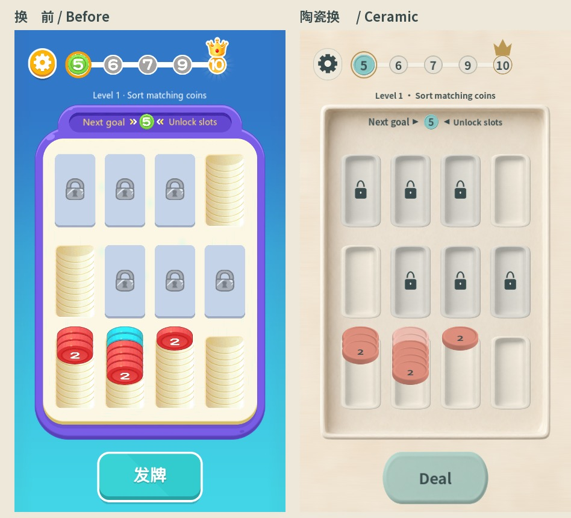

# 实际引用图片与陶瓷换皮清单

核查日期：2026-10-20。游戏名称：**合并硬币 / Coin Merge**。本轮完成图片与字体替换并接入 Godot 4.7.2；玩法、关卡、存档格式与交互区域保持现状。

## 核查结论

- 换皮前实际引用 **104 个图片文件**；本轮替换 **103 张**，另外 **1 张旧数字字体图集随 FNT 移除**。换皮后实际图片依赖为 **103 张原创替代 PNG**。
- 动态范围：普通币 1–16（第 16 张为隐藏币）、挑战 War1–War11、大币 BigCoin1–BigCoin15。未把未使用的 BigCoin16 或 BigCoin10-(2) 计入。
- 活跃依赖已无 `assets/rea_original` 图片、原数字 FNT/图集或 SystemFont；字体随包提供，已关闭操作系统字体回退。
- **14 种原作音效明确保留，授权或重新制作仍为后续待办。**初步计划中的 13 种漏算了 Tween 回调 `_sound.bind("placeCoin")`；完整核查已计入。换皮前冻结 JSON 保留初次扫描值，音效最终清单以修正后的 after.json 和本表为准。本轮图片和字体换皮不表示音效、游戏名称商标或整包发行权利已完成核验。
- 原图片均保留原字节。尤其是开始前已修改的 `assets/rea_original/sprites/ui/logo_zh.png`，已用换皮前 SHA-256 再核对，未覆盖。

## 依赖追踪边界

从 `project.godot` 主场景 `scenes/main_menu.tscn` 与自动加载入口追踪静态资源和脚本，再沿场景跳转、继承脚本、动态根路径、硬币编号、粒子配置与 FNT 页继续展开。前后各有 41 个可达源文件（加入共享视觉配置，移除旧 FNT）。

完整前后源文件集合、引用行号、尺寸、alpha 边界、文件字节数与 SHA-256 见 [before.json](reskin/before.json)、[after.json](reskin/after.json)。工具为 [audit_image_usage.py](../tools/audit_image_usage.py)。动态家族是针对本项目加载规则显式展开，并非通用 GDScript 解释器。新增家族需要同步扩展规则。

“仅声明引用”与“整张图片未使用”分别记录：旧 `scenes/game.tscn` 有 4 条未赋给节点的 ext_resource（BG_Lock、Icon_Lock、BG_Trench、normal/1），这些图片同时被脚本实际使用，因此仍属于 104 张。本轮移除了这 4 条冗余声明。

另有 **139 张**仓库原作图片不在运行依赖中，列入 [historical-images.json](reskin/historical-images.json)，不计入 104 张。历史图集、Spine 文件、备用大币和取证图属于这个范围。

已在原作 `sprites/`、`fonts/`、`particles/`、`atlases/`、`spine/` 增加 `.gdignore`；原 `reference/` 已排除。母版和处理中间件放在 `art-source/ceramic/`，证据放在 `docs/reskin/`，二者也有 `.gdignore`。原作 `audio/` 继续使用。默认 `icon.svg` 不再被项目引用。发布时按发布工程的依赖范围导出，并继续排除文档、测试和美术源文件；本轮未生成或认证抖音发布包。

## 制作与接入

使用用户已配置的 **imagegen CLI / gpt-image-2.5**，在进程内从 Codex 配置读取请求地址与密钥；项目未保存凭据。先生成并检查斜视硬币和面板两张，再以最多 2 个并发请求生成其余 8 张。所有请求均为纯文字生成，没有上传原作图片。

10 类母版：斜视硬币、正视硬币、背景、托盘、槽位、面板、按钮、挑战卡片、云朵与手势。精确提示词见 [prompts.json](../art-source/ceramic/prompts.json)，批次、完成时间与生成记录见 [generation.json](../art-source/ceramic/generation.json)，原输出见 [masters/](../art-source/ceramic/masters/)，尺寸与摘要见 [mapping.json](reskin/mapping.json)。供应方未严格遵守 1024×1024 请求，实际尺寸另行记录，最终画布均由本地处理落实。

透明对象使用纯品红背景生成，抠图时反解边缘混色，原始母版与抠图中间件分别保留；彩色硬币由中性母版着色派生。图标、蒙版、圆环、光晕、扫光和碎片使用本项目几何/渐变绘制。Logo 使用新币图与授权字体重新排版。

运行资源根为 `assets/reskin/ceramic/`，共享路径、字体和配色在 [ceramic_skin.gd](../scripts/ceramic_skin.gd)。普通模式音效根已从图片根拆开。挑战箭头与 War 硬币使用同一配色表，数字仍由代码叠加；旧发牌图片中的中文字改为可翻译 Label。

保留 101×67 硬币画布、164×172 大币画布、19 px 堆叠间距、动画锚点、布局和点击区；只在币面内部调整数字/问号位置。新九宫格切片边距统一为 24 px，内容留白与按钮点击区维持原布局。面板和按钮文字改为深色陶瓷墨色。

### 字体来源与许可

官方 Google Fonts 仓库的 Noto Sans SC，SIL Open Font License 1.1。制作 650 字重静态子集并改名为 **Coin Merge UI**，当前包含 **457** 个字符映射，大小 **110,080 B**。项目当前全部翻译字段由实际 FontFile 检查，无缺字。

- [字体许可证 OFL.txt](../assets/reskin/ceramic/fonts/OFL.txt)
- [来源 URL 与源字体/子集 SHA-256](../assets/reskin/ceramic/fonts/provenance.json)
- [子集生成工具](../tools/build_ceramic_font.py)；下载的全量字库仅作为本地缓存，不打入游戏。

## 逐项替换台账

下表编号与前后缩略图一致。旧资源列相对 `assets/rea_original/`，新资源列相对 `assets/reskin/ceramic/`；`icon.svg` 为项目根文件。尺寸单位为 px，bbox 为 `[left, top, right, bottom]`、右/下边界不含自身；它表示非透明区域包围盒，内部孔洞与半透明边缘详见 JSON。

所有行的旧/新 SHA-256、alpha 透明/半透明比例、派生来源与可达验证结果都在 [ledger.json](reskin/ledger.json)。表中“通过”表示文件存在、画布/依赖与原始字节追溯通过；动态加载、字体与代表界面另经下文测试及截图验收。

| # | 旧图片 | 用途 / 动态范围 | 原尺寸；非透明 bbox | 换皮前引用位置 | 新资源 / 结论 | 验收 |
|---|---|---|---|---|---|---|
| 001 | `fonts/number01/number01.png` | 旧数字位图字体页；经 number01.fnt 间接引用 | 238×92；[2,2,234,89] | `assets/rea_original/fonts/number01/number01.fnt:3`（FNT页） | `移除图集；改用 fonts/CoinMergeUI.ttf` | 通过 |
| 002 | `particles/atom.texture.png` | 粒子微光点（相对 ../particles 动态加载） | 31×31；[0,0,31,31] | `scripts/normal_particle_data.gd:106` | `particles/atom.texture.png` | 通过 |
| 003 | `sprites/Texture/Challenge/BG_Choose.png` | 当前挑战卡片选中边框 | 122×160；[0,0,122,160] | `scripts/challenge_menu.gd:150` | `sprites/Texture/Challenge/BG_Choose.png` | 通过 |
| 004 | `sprites/Texture/Challenge/Flag.png` | 当前挑战卡片标志 | 48×60；[0,0,48,60] | `scripts/challenge_menu.gd:151` | `sprites/Texture/Challenge/Flag.png` | 通过 |
| 005 | `sprites/Texture/Challenge/LevelBG.png` | 挑战关卡卡片底板 | 90×128；[0,0,90,128] | `scripts/challenge_menu.gd:140` | `sprites/Texture/Challenge/LevelBG.png` | 通过 |
| 006 | `sprites/Texture/Challenge/Partten.png` | 已完成挑战卡片 | 90×128；[0,0,90,128] | `scripts/challenge_menu.gd:154` | `sprites/Texture/Challenge/Partten.png` | 通过 |
| 007 | `sprites/Texture/Challenge/Unlock.png` | 可挑战卡片标志 | 49×64；[0,0,49,64] | `scripts/challenge_menu.gd:145` | `sprites/Texture/Challenge/Unlock.png` | 通过 |
| 008 | `sprites/Texture/skin/BG_Lock.png` | 锁定槽底板 | 114×205；[1,1,113,204] | `scenes/game.tscn:10`（仅声明）<br>`scripts/coin_slot.gd:13` | `sprites/Texture/skin/BG_Lock.png` | 通过 |
| 009 | `sprites/Texture/skin/BG_Lock2.png` | 可解锁槽 / 扫光底板 | 110×200；[0,0,110,200] | `scripts/coin_slot.gd:14` | `sprites/Texture/skin/BG_Lock2.png` | 通过 |
| 010 | `sprites/Texture/skin/BG_Lock_AD.png` | 奖励槽底板 | 112×203；[0,0,112,203] | `scripts/coin_slot.gd:16` | `sprites/Texture/skin/BG_Lock_AD.png` | 通过 |
| 011 | `sprites/Texture/skin/BG_Trench.png` | 开放槽底板 | 122×213；[1,1,121,212] | `scenes/game.tscn:12`（仅声明）<br>`scripts/challenge_slot.gd:39`<br>`scripts/coin_slot.gd:11` | `sprites/Texture/skin/BG_Trench.png` | 通过 |
| 012 | `sprites/Texture/skin/BG_Trench_Merge.png` | 可合并描边与光效 | 132×222；[0,0,132,222] | `scripts/coin_slot.gd:12` | `sprites/Texture/skin/BG_Trench_Merge.png` | 通过 |
| 013 | `sprites/Texture/skin/Bg_Mask.png` | 挑战棋盘背景 / 槽底遮挡 | 32×32；[0,0,32,32] | `scripts/challenge.gd:76`<br>`scripts/challenge_slot.gd:45` | `sprites/Texture/skin/Bg_Mask.png` | 通过 |
| 014 | `sprites/Texture/skin/CoinMask.png` | 挑战币扫光的 alpha 蒙版 | 100×229；[0,0,100,229] | `scripts/challenge_slot.gd:183` | `sprites/Texture/skin/CoinMask.png` | 通过 |
| 015 | `sprites/Texture/skin/ColorArrow.png` | 可调色挑战目标箭头（白色源图） | 32×21；[0,0,32,21] | `scripts/challenge_slot.gd:49` | `sprites/Texture/skin/ColorArrow.png` | 通过 |
| 016 | `sprites/Texture/skin/Icon_QuestionMark.png` | 隐藏币问号 | 40×53；[0,0,40,53] | `scripts/coin_visual.gd:43` | `sprites/Texture/skin/Icon_QuestionMark.png` | 通过 |
| 017 | `sprites/Texture/skin/TargetArrow1.png` | 普通目标指示箭头 | 20×17；[0,0,20,17] | `scenes/game.tscn:21` | `sprites/Texture/skin/TargetArrow1.png` | 通过 |
| 018 | `sprites/Texture/skin/TargetBG_1.png` | 未到达的目标底板 | 56×56；[0,0,56,56] | `scenes/game.tscn:17`<br>`scripts/normal_progress.gd:31` | `sprites/Texture/skin/TargetBG_1.png` | 通过 |
| 019 | `sprites/Texture/skin/TargetBG_2.png` | 当前目标圆环 | 72×74；[1,1,72,74] | `scenes/game.tscn:18`<br>`scripts/normal_progress.gd:38` | `sprites/Texture/skin/TargetBG_2.png` | 通过 |
| 020 | `sprites/Texture/skin/TargetBG_5.png` | 已完成目标标记 | 56×56；[0,0,56,56] | `scripts/normal_progress.gd:40` | `sprites/Texture/skin/TargetBG_5.png` | 通过 |
| 021 | `sprites/Texture/skin/Tick.png` | 挑战整槽完成勾 | 73×57；[0,0,73,57] | `scripts/challenge_slot.gd:51` | `sprites/Texture/skin/Tick.png` | 通过 |
| 022 | `sprites/Texture/skin/big/BigCoin1.png` | 目标 / 奖励 / 升级大币；动态 BigCoin1–BigCoin15 | 164×172；[0,0,164,169] | `scripts/challenge_menu.gd:237`<br>`scripts/challenge_menu.gd:282`<br>`scripts/game.gd:136`<br>`scripts/gameplay_dialog.gd:152`<br>`scripts/normal_effects.gd:46`<br>`scripts/normal_progress.gd:75` | `sprites/Texture/skin/big/BigCoin1.png` | 通过 |
| 023 | `sprites/Texture/skin/big/BigCoin10.png` | 目标 / 奖励 / 升级大币；动态 BigCoin1–BigCoin15 | 164×172；[0,0,164,168] | `scripts/challenge_menu.gd:282`<br>`scripts/game.gd:136`<br>`scripts/gameplay_dialog.gd:152`<br>`scripts/normal_effects.gd:46`<br>`scripts/normal_progress.gd:75` | `sprites/Texture/skin/big/BigCoin10.png` | 通过 |
| 024 | `sprites/Texture/skin/big/BigCoin11.png` | 目标 / 奖励 / 升级大币；动态 BigCoin1–BigCoin15 | 164×172；[0,0,164,168] | `scripts/challenge_menu.gd:282`<br>`scripts/game.gd:136`<br>`scripts/gameplay_dialog.gd:152`<br>`scripts/normal_effects.gd:46`<br>`scripts/normal_progress.gd:75` | `sprites/Texture/skin/big/BigCoin11.png` | 通过 |
| 025 | `sprites/Texture/skin/big/BigCoin12.png` | 目标 / 奖励 / 升级大币；动态 BigCoin1–BigCoin15 | 164×172；[0,0,164,168] | `scripts/challenge_menu.gd:282`<br>`scripts/game.gd:136`<br>`scripts/gameplay_dialog.gd:152`<br>`scripts/normal_effects.gd:46`<br>`scripts/normal_progress.gd:75` | `sprites/Texture/skin/big/BigCoin12.png` | 通过 |
| 026 | `sprites/Texture/skin/big/BigCoin13.png` | 目标 / 奖励 / 升级大币；动态 BigCoin1–BigCoin15 | 164×172；[0,0,164,168] | `scripts/challenge_menu.gd:282`<br>`scripts/game.gd:136`<br>`scripts/gameplay_dialog.gd:152`<br>`scripts/normal_effects.gd:46`<br>`scripts/normal_progress.gd:75` | `sprites/Texture/skin/big/BigCoin13.png` | 通过 |
| 027 | `sprites/Texture/skin/big/BigCoin14.png` | 目标 / 奖励 / 升级大币；动态 BigCoin1–BigCoin15 | 164×172；[0,0,164,168] | `scripts/challenge_menu.gd:282`<br>`scripts/game.gd:136`<br>`scripts/gameplay_dialog.gd:152`<br>`scripts/normal_effects.gd:46`<br>`scripts/normal_progress.gd:75` | `sprites/Texture/skin/big/BigCoin14.png` | 通过 |
| 028 | `sprites/Texture/skin/big/BigCoin15.png` | 目标 / 奖励 / 升级大币；动态 BigCoin1–BigCoin15 | 164×172；[0,0,164,168] | `scripts/challenge_menu.gd:282`<br>`scripts/game.gd:136`<br>`scripts/gameplay_dialog.gd:152`<br>`scripts/normal_effects.gd:46`<br>`scripts/normal_progress.gd:75` | `sprites/Texture/skin/big/BigCoin15.png` | 通过 |
| 029 | `sprites/Texture/skin/big/BigCoin2.png` | 目标 / 奖励 / 升级大币；动态 BigCoin1–BigCoin15 | 164×172；[0,0,164,169] | `scripts/challenge_menu.gd:282`<br>`scripts/game.gd:136`<br>`scripts/gameplay_dialog.gd:152`<br>`scripts/normal_effects.gd:46`<br>`scripts/normal_progress.gd:75` | `sprites/Texture/skin/big/BigCoin2.png` | 通过 |
| 030 | `sprites/Texture/skin/big/BigCoin3.png` | 目标 / 奖励 / 升级大币；动态 BigCoin1–BigCoin15 | 164×172；[0,1,164,168] | `scripts/challenge_menu.gd:282`<br>`scripts/game.gd:136`<br>`scripts/gameplay_dialog.gd:152`<br>`scripts/normal_effects.gd:46`<br>`scripts/normal_progress.gd:75` | `sprites/Texture/skin/big/BigCoin3.png` | 通过 |
| 031 | `sprites/Texture/skin/big/BigCoin4.png` | 目标 / 奖励 / 升级大币；动态 BigCoin1–BigCoin15 | 164×172；[0,0,164,169] | `scripts/challenge_menu.gd:282`<br>`scripts/game.gd:136`<br>`scripts/gameplay_dialog.gd:152`<br>`scripts/normal_effects.gd:46`<br>`scripts/normal_progress.gd:75` | `sprites/Texture/skin/big/BigCoin4.png` | 通过 |
| 032 | `sprites/Texture/skin/big/BigCoin5.png` | 目标 / 奖励 / 升级大币；动态 BigCoin1–BigCoin15 | 164×172；[0,0,164,168] | `scenes/game.tscn:14`<br>`scripts/challenge_menu.gd:282`<br>`scripts/game.gd:136`<br>`scripts/gameplay_dialog.gd:152`<br>`scripts/normal_effects.gd:46`<br>`scripts/normal_progress.gd:39`<br>`scripts/normal_progress.gd:75` | `sprites/Texture/skin/big/BigCoin5.png` | 通过 |
| 033 | `sprites/Texture/skin/big/BigCoin6.png` | 目标 / 奖励 / 升级大币；动态 BigCoin1–BigCoin15 | 164×172；[0,0,164,168] | `scripts/challenge_menu.gd:282`<br>`scripts/game.gd:136`<br>`scripts/gameplay_dialog.gd:152`<br>`scripts/normal_effects.gd:46`<br>`scripts/normal_progress.gd:75` | `sprites/Texture/skin/big/BigCoin6.png` | 通过 |
| 034 | `sprites/Texture/skin/big/BigCoin7.png` | 目标 / 奖励 / 升级大币；动态 BigCoin1–BigCoin15 | 164×172；[0,1,164,168] | `scripts/challenge_menu.gd:282`<br>`scripts/game.gd:136`<br>`scripts/gameplay_dialog.gd:152`<br>`scripts/normal_effects.gd:46`<br>`scripts/normal_progress.gd:75` | `sprites/Texture/skin/big/BigCoin7.png` | 通过 |
| 035 | `sprites/Texture/skin/big/BigCoin8.png` | 目标 / 奖励 / 升级大币；动态 BigCoin1–BigCoin15 | 164×172；[0,0,164,168] | `scripts/challenge_menu.gd:282`<br>`scripts/game.gd:136`<br>`scripts/gameplay_dialog.gd:152`<br>`scripts/normal_effects.gd:46`<br>`scripts/normal_progress.gd:75` | `sprites/Texture/skin/big/BigCoin8.png` | 通过 |
| 036 | `sprites/Texture/skin/big/BigCoin9.png` | 目标 / 奖励 / 升级大币；动态 BigCoin1–BigCoin15 | 164×172；[0,0,164,168] | `scripts/challenge_menu.gd:282`<br>`scripts/game.gd:136`<br>`scripts/gameplay_dialog.gd:152`<br>`scripts/normal_effects.gd:46`<br>`scripts/normal_progress.gd:75` | `sprites/Texture/skin/big/BigCoin9.png` | 通过 |
| 037 | `sprites/Texture/skin/normal/1.png` | 普通硬币 / 隐藏币；动态 1–16，等级按 15 色循环；数字由代码叠加 | 101×67；[0,0,101,67] | `scenes/game.tscn:13`（仅声明）<br>`scripts/coin_visual.gd:49` | `sprites/Texture/skin/normal/1.png` | 通过 |
| 038 | `sprites/Texture/skin/normal/10.png` | 普通硬币 / 隐藏币；动态 1–16，等级按 15 色循环；数字由代码叠加 | 101×67；[0,0,101,67] | `scripts/coin_visual.gd:49` | `sprites/Texture/skin/normal/10.png` | 通过 |
| 039 | `sprites/Texture/skin/normal/11.png` | 普通硬币 / 隐藏币；动态 1–16，等级按 15 色循环；数字由代码叠加 | 101×67；[0,0,101,67] | `scripts/coin_visual.gd:49` | `sprites/Texture/skin/normal/11.png` | 通过 |
| 040 | `sprites/Texture/skin/normal/12.png` | 普通硬币 / 隐藏币；动态 1–16，等级按 15 色循环；数字由代码叠加 | 101×67；[0,0,101,67] | `scripts/coin_visual.gd:49` | `sprites/Texture/skin/normal/12.png` | 通过 |
| 041 | `sprites/Texture/skin/normal/13.png` | 普通硬币 / 隐藏币；动态 1–16，等级按 15 色循环；数字由代码叠加 | 101×67；[0,0,101,67] | `scripts/coin_visual.gd:49` | `sprites/Texture/skin/normal/13.png` | 通过 |
| 042 | `sprites/Texture/skin/normal/14.png` | 普通硬币 / 隐藏币；动态 1–16，等级按 15 色循环；数字由代码叠加 | 101×67；[0,0,101,67] | `scripts/coin_visual.gd:49` | `sprites/Texture/skin/normal/14.png` | 通过 |
| 043 | `sprites/Texture/skin/normal/15.png` | 普通硬币 / 隐藏币；动态 1–16，等级按 15 色循环；数字由代码叠加 | 101×67；[0,0,101,67] | `scripts/coin_visual.gd:49` | `sprites/Texture/skin/normal/15.png` | 通过 |
| 044 | `sprites/Texture/skin/normal/16.png` | 普通硬币 / 隐藏币；动态 1–16，等级按 15 色循环；数字由代码叠加 | 101×67；[0,0,101,67] | `scripts/coin_visual.gd:49` | `sprites/Texture/skin/normal/16.png` | 通过 |
| 045 | `sprites/Texture/skin/normal/2.png` | 普通硬币 / 隐藏币；动态 1–16，等级按 15 色循环；数字由代码叠加 | 101×67；[0,0,101,67] | `scripts/coin_visual.gd:49` | `sprites/Texture/skin/normal/2.png` | 通过 |
| 046 | `sprites/Texture/skin/normal/3.png` | 普通硬币 / 隐藏币；动态 1–16，等级按 15 色循环；数字由代码叠加 | 101×67；[0,0,101,67] | `scripts/coin_visual.gd:49` | `sprites/Texture/skin/normal/3.png` | 通过 |
| 047 | `sprites/Texture/skin/normal/4.png` | 普通硬币 / 隐藏币；动态 1–16，等级按 15 色循环；数字由代码叠加 | 101×67；[0,0,101,67] | `scripts/coin_visual.gd:49` | `sprites/Texture/skin/normal/4.png` | 通过 |
| 048 | `sprites/Texture/skin/normal/5.png` | 普通硬币 / 隐藏币；动态 1–16，等级按 15 色循环；数字由代码叠加 | 101×67；[0,0,101,67] | `scripts/coin_visual.gd:49` | `sprites/Texture/skin/normal/5.png` | 通过 |
| 049 | `sprites/Texture/skin/normal/6.png` | 普通硬币 / 隐藏币；动态 1–16，等级按 15 色循环；数字由代码叠加 | 101×67；[0,0,101,67] | `scripts/coin_visual.gd:49` | `sprites/Texture/skin/normal/6.png` | 通过 |
| 050 | `sprites/Texture/skin/normal/7.png` | 普通硬币 / 隐藏币；动态 1–16，等级按 15 色循环；数字由代码叠加 | 101×67；[0,0,101,67] | `scripts/coin_visual.gd:49` | `sprites/Texture/skin/normal/7.png` | 通过 |
| 051 | `sprites/Texture/skin/normal/8.png` | 普通硬币 / 隐藏币；动态 1–16，等级按 15 色循环；数字由代码叠加 | 101×67；[0,0,101,67] | `scripts/coin_visual.gd:49` | `sprites/Texture/skin/normal/8.png` | 通过 |
| 052 | `sprites/Texture/skin/normal/9.png` | 普通硬币 / 隐藏币；动态 1–16，等级按 15 色循环；数字由代码叠加 | 101×67；[0,0,101,67] | `scripts/coin_visual.gd:49` | `sprites/Texture/skin/normal/9.png` | 通过 |
| 053 | `sprites/Texture/skin/war/War1.png` | 挑战硬币；动态 War1–War11，与目标箭头共用配色 | 101×67；[0,0,101,67] | `scripts/coin_visual.gd:51` | `sprites/Texture/skin/war/War1.png` | 通过 |
| 054 | `sprites/Texture/skin/war/War10.png` | 挑战硬币；动态 War1–War11，与目标箭头共用配色 | 101×67；[0,0,101,67] | `scripts/coin_visual.gd:51` | `sprites/Texture/skin/war/War10.png` | 通过 |
| 055 | `sprites/Texture/skin/war/War11.png` | 挑战硬币；动态 War1–War11，与目标箭头共用配色 | 101×67；[0,0,101,67] | `scripts/coin_visual.gd:51` | `sprites/Texture/skin/war/War11.png` | 通过 |
| 056 | `sprites/Texture/skin/war/War2.png` | 挑战硬币；动态 War1–War11，与目标箭头共用配色 | 101×67；[0,0,101,67] | `scripts/coin_visual.gd:51` | `sprites/Texture/skin/war/War2.png` | 通过 |
| 057 | `sprites/Texture/skin/war/War3.png` | 挑战硬币；动态 War1–War11，与目标箭头共用配色 | 101×67；[0,0,101,67] | `scripts/coin_visual.gd:51` | `sprites/Texture/skin/war/War3.png` | 通过 |
| 058 | `sprites/Texture/skin/war/War4.png` | 挑战硬币；动态 War1–War11，与目标箭头共用配色 | 101×67；[0,0,101,67] | `scripts/coin_visual.gd:51` | `sprites/Texture/skin/war/War4.png` | 通过 |
| 059 | `sprites/Texture/skin/war/War5.png` | 挑战硬币；动态 War1–War11，与目标箭头共用配色 | 101×67；[0,0,101,67] | `scripts/coin_visual.gd:51` | `sprites/Texture/skin/war/War5.png` | 通过 |
| 060 | `sprites/Texture/skin/war/War6.png` | 挑战硬币；动态 War1–War11，与目标箭头共用配色 | 101×67；[0,0,101,67] | `scripts/coin_visual.gd:51` | `sprites/Texture/skin/war/War6.png` | 通过 |
| 061 | `sprites/Texture/skin/war/War7.png` | 挑战硬币；动态 War1–War11，与目标箭头共用配色 | 101×67；[0,0,101,67] | `scripts/coin_visual.gd:51` | `sprites/Texture/skin/war/War7.png` | 通过 |
| 062 | `sprites/Texture/skin/war/War8.png` | 挑战硬币；动态 War1–War11，与目标箭头共用配色 | 101×67；[0,0,101,67] | `scripts/coin_visual.gd:51` | `sprites/Texture/skin/war/War8.png` | 通过 |
| 063 | `sprites/Texture/skin/war/War9.png` | 挑战硬币；动态 War1–War11，与目标箭头共用配色 | 101×67；[0,0,101,67] | `scripts/coin_visual.gd:51` | `sprites/Texture/skin/war/War9.png` | 通过 |
| 064 | `sprites/spine_cloud/could1.png` | 主菜单云朵；保留当前 Tween 动画 | 489×347；[0,1,488,347] | `scenes/main_menu.tscn:8`（仅声明） | `sprites/spine_cloud/could1.png` | 通过 |
| 065 | `sprites/spine_cloud/could2.png` | 主菜单云朵；保留当前 Tween 动画 | 449×419；[1,1,449,419] | `scenes/main_menu.tscn:7`（仅声明） | `sprites/spine_cloud/could2.png` | 通过 |
| 066 | `sprites/spine_cloud/could3.png` | 主菜单云朵；保留当前 Tween 动画 | 750×533；[0,1,750,533] | `scenes/main_menu.tscn:6`（仅声明） | `sprites/spine_cloud/could3.png` | 通过 |
| 067 | `sprites/ui/BG.png` | 普通/主菜单/挑战选关背景 | 23×1623；[0,0,23,1623] | `scenes/game.tscn:5`<br>`scenes/main_menu.tscn:4`（仅声明）<br>`scripts/challenge_screen.gd:21` | `sprites/ui/BG.png` | 通过 |
| 068 | `sprites/ui/Box2.png` | 普通棋盘托盘 | 321×330；[1,1,320,329] | `scenes/game.tscn:9` | `sprites/ui/Box2.png` | 通过 |
| 069 | `sprites/ui/Btn_Ad_broad.png` | 救援奖励按钮底板 | 225×96；[1,1,224,95] | `scripts/dialog_style.gd:10` | `sprites/ui/Btn_Ad_broad.png` | 通过 |
| 070 | `sprites/ui/Btn_Begin_38px.png` | 主菜单开始按钮底板 | 162×171；[1,1,161,170] | `scenes/main_menu.tscn:9`（仅声明） | `sprites/ui/Btn_Begin_38px.png` | 通过 |
| 071 | `sprites/ui/Btn_Deal.png` | 发牌按钮底板；文字改用可翻译 Label | 294×147；[1,1,293,147] | `scenes/game.tscn:22` | `sprites/ui/Btn_Deal.png` | 通过 |
| 072 | `sprites/ui/Btn_Quit.png` | 关闭按钮 | 81×81；[1,1,80,80] | `scenes/settings_dialog.tscn:5`<br>`scripts/challenge_menu.gd:61`<br>`scripts/dialog_style.gd:87` | `sprites/ui/Btn_Quit.png` | 通过 |
| 073 | `sprites/ui/Btn_Setting_2acdf23c.png` | 设置按钮 | 91×101；[1,1,90,100] | `scenes/game.tscn:8`<br>`scenes/main_menu.tscn:11`（仅声明）<br>`scripts/challenge_screen.gd:92` | `sprites/ui/Btn_Setting_2acdf23c.png` | 通过 |
| 074 | `sprites/ui/Btn_War_24px.png` | 主菜单挑战按钮底板 | 158×130；[1,1,157,129] | `scenes/main_menu.tscn:10`（仅声明） | `sprites/ui/Btn_War_24px.png` | 通过 |
| 075 | `sprites/ui/Btn_blue_25px.png` | 通用薄荷色按钮 | 117×100；[0,0,117,100] | `scenes/settings_dialog.tscn:9`<br>`scripts/dialog_style.gd:7` | `sprites/ui/Btn_blue_25px.png` | 通过 |
| 076 | `sprites/ui/Btn_green_25px.png` | 通用鼠尾草色按钮 | 113×107；[0,0,113,107] | `scripts/dialog_style.gd:9` | `sprites/ui/Btn_green_25px.png` | 通过 |
| 077 | `sprites/ui/Btn_yellow_25px.png` | 通用暖沙色按钮 | 107×100；[1,1,106,99] | `scenes/settings_dialog.tscn:10`<br>`scripts/dialog_style.gd:8` | `sprites/ui/Btn_yellow_25px.png` | 通过 |
| 078 | `sprites/ui/CoinBg.png` | 挑战关卡与计时底板 | 172×83；[0,0,172,83] | `scripts/challenge.gd:81` | `sprites/ui/CoinBg.png` | 通过 |
| 079 | `sprites/ui/Gold_Small.png` | 首次通关金币奖励图标 | 55×55；[0,0,55,55] | `scripts/gameplay_dialog.gd:104` | `sprites/ui/Gold_Small.png` | 通过 |
| 080 | `sprites/ui/Guide_Hand.png` | 教程点击手势 | 146×144；[0,0,146,144] | `scripts/normal_tutorial.gd:42` | `sprites/ui/Guide_Hand.png` | 通过 |
| 081 | `sprites/ui/Guide_Mask1.png` | 教程单槽 alpha 镂空形状 | 146×252；[0,0,146,252] | `scripts/normal_tutorial.gd:58` | `sprites/ui/Guide_Mask1.png` | 通过 |
| 082 | `sprites/ui/Guide_Mask2.png` | 教程目标 alpha 镂空形状 | 124×164；[0,0,124,164] | `scripts/normal_tutorial.gd:58` | `sprites/ui/Guide_Mask2.png` | 通过 |
| 083 | `sprites/ui/Guide_Mask3.png` | 教程横向按钮 alpha 镂空形状 | 317×158；[0,0,317,158] | `scripts/normal_tutorial.gd:58` | `sprites/ui/Guide_Mask3.png` | 通过 |
| 084 | `sprites/ui/Icon_Lock.png` | 锁定图标 | 43×57；[0,0,43,57] | `scenes/game.tscn:11`（仅声明）<br>`scripts/challenge_menu.gd:143`<br>`scripts/coin_slot.gd:17` | `sprites/ui/Icon_Lock.png` | 通过 |
| 085 | `sprites/ui/Icon_Unlock.png` | 可解锁图标 | 49×57；[0,0,49,57] | `scripts/coin_slot.gd:18` | `sprites/ui/Icon_Unlock.png` | 通过 |
| 086 | `sprites/ui/Icon_ad_2.png` | 奖励视频播放图标 | 72×46；[1,1,71,45] | `scripts/coin_slot.gd:19` | `sprites/ui/Icon_ad_2.png` | 通过 |
| 087 | `sprites/ui/Icon_spot_1.png` | 选关当前页圆点 | 36×36；[1,1,35,35] | `scripts/challenge_menu.gd:118` | `sprites/ui/Icon_spot_1.png` | 通过 |
| 088 | `sprites/ui/Icon_spot_2.png` | 选关其他页圆点 | 36×36；[1,1,35,35] | `scripts/challenge_menu.gd:83`<br>`scripts/challenge_menu.gd:118` | `sprites/ui/Icon_spot_2.png` | 通过 |
| 089 | `sprites/ui/LaserLight.png` | 解锁 / 硬币扫光纹理 | 122×180；[11,0,112,180] | `scripts/challenge_slot.gd:186`<br>`scripts/coin_slot.gd:55`<br>`scripts/normal_effects.gd:77` | `sprites/ui/LaserLight.png` | 通过 |
| 090 | `sprites/ui/Light1.png` | 粒子柔光纹理 | 24×24；[0,0,24,24] | `scripts/challenge_slot.gd:14`<br>`scripts/normal_particle_data.gd:53`<br>`scripts/normal_particle_data.gd:257`<br>`scripts/normal_particle_data.gd:307` | `sprites/ui/Light1.png` | 通过 |
| 091 | `sprites/ui/PanelBG.png` | 设置、提示、救援、选关及结算九宫格 | 316×243；[1,1,315,242] | `scenes/settings_dialog.tscn:4`<br>`scripts/challenge_menu.gd:46`<br>`scripts/dialog_style.gd:61` | `sprites/ui/PanelBG.png` | 通过 |
| 092 | `sprites/ui/Pieces1.png` | 粒子几何碎片 1 | 20×28；[0,0,20,28] | `scripts/normal_particle_data.gd:160` | `sprites/ui/Pieces1.png` | 通过 |
| 093 | `sprites/ui/Pieces2.png` | 粒子几何碎片 2 | 24×24；[0,0,24,24] | `scripts/normal_particle_data.gd:212` | `sprites/ui/Pieces2.png` | 通过 |
| 094 | `sprites/ui/ProcessBG.png` | 挑战完成数量底板 | 124×64；[0,0,124,64] | `scripts/challenge.gd:88` | `sprites/ui/ProcessBG.png` | 通过 |
| 095 | `sprites/ui/Set_broad.png` | 设置开关关闭轨道 | 129×78；[1,1,128,77] | `scenes/settings_dialog.tscn:6` | `sprites/ui/Set_broad.png` | 通过 |
| 096 | `sprites/ui/Set_broad_2.png` | 设置开关开启轨道 | 128×78；[1,1,127,77] | `scenes/settings_dialog.tscn:7` | `sprites/ui/Set_broad_2.png` | 通过 |
| 097 | `sprites/ui/Set_btn.png` | 设置开关滑块 | 54×58；[1,1,53,57] | `scenes/settings_dialog.tscn:8` | `sprites/ui/Set_btn.png` | 通过 |
| 098 | `sprites/ui/TargetBG_4.png` | 最终目标放射光 | 113×112；[0,0,113,112] | `scenes/game.tscn:23`<br>`scripts/normal_progress.gd:30` | `sprites/ui/TargetBG_4.png` | 通过 |
| 099 | `sprites/ui/TargetBG_4_b515ca35.png` | 最终目标圆环 | 77×77；[1,1,76,76] | `scenes/game.tscn:19`<br>`scripts/normal_progress.gd:31` | `sprites/ui/TargetBG_4_b515ca35.png` | 通过 |
| 100 | `sprites/ui/TargetBG_4_d27bfba7.png` | 最终目标皇冠 | 68×54；[1,1,67,53] | `scenes/game.tscn:20`<br>`scripts/normal_progress.gd:52` | `sprites/ui/TargetBG_4_d27bfba7.png` | 通过 |
| 101 | `sprites/ui/TargetBar.png` | 普通目标连接条 | 50×28；[0,0,50,28] | `scenes/game.tscn:16` | `sprites/ui/TargetBar.png` | 通过 |
| 102 | `sprites/ui/logo_en.png` | 英文 Coin Merge 标题 | 1286×1223；[0,0,1286,1223] | `scenes/main_menu.tscn:14`（仅声明） | `sprites/ui/logo_en.png` | 通过 |
| 103 | `sprites/ui/logo_zh.png` | 中文合并硬币标题 | 1402×1122；[51,9,1384,1122] | `scenes/main_menu.tscn:5`（仅声明） | `sprites/ui/logo_zh.png` | 通过 |
| 104 | `icon.svg` | 默认项目图标 | 128×128；[矢量] | `project.godot:16` | `app-icon.png` | 通过 |

## 视觉证据与验收



- [104 项原资源缩略图索引](reskin/contact-before.jpg) / [对应替换索引](reskin/contact-after.jpg)
- [深色与浅色底透明边缘、蒙版和扫光检查](reskin/alpha-edges.jpg)
- [全部普通/挑战币、目标配色与字形](reskin/after/palette-and-glyphs.png)
- [中文主菜单](reskin/after/menu-zh.png) / [英文主菜单](reskin/after/menu-en.png)
- [中文设置](reskin/after/settings-zh.png) / [英文设置](reskin/after/settings-en.png)
- [普通教程](reskin/after/normal-mode-tutorial.png) / [奖励槽开放后](reskin/after/normal-mode-playing.png) / [失败救援](reskin/after/normal-mode-rescue.png) / [最终庆祝](reskin/after/normal-mode-final-congrats.png)
- [挑战选关](reskin/after/challenge-selection.png) / [第 7 页](reskin/after/challenge-selection-page-6.png) / [锁关提示](reskin/after/challenge-unlock.png)
- [挑战教程](reskin/after/challenge-tutorial.png) / [正式关](reskin/after/challenge-level-1.png) / [英文界面](reskin/after/challenge-english.png) / [结算](reskin/after/challenge-success.png) / [纪录](reskin/after/challenge-record.png) / [208 槽](reskin/after/challenge-dense-board.png)

切边检查未发现可见品红溢色。全体替代图的可见像素品红残留检测为 0（阈值与 alpha 统计见生成报告工具）。教程蒙版为新的白色 alpha 形状，着色器仍以 alpha 镂空；扫光为独立透明梯度。九宫格在设置、救援、选关与结算不同尺寸均有截图。

| 验证 | 本次结果 | 证据 |
|---|---|---|
| 普通规则 | 3,487 项，0 失败 | [日志](reskin/after-normal-rules.log) |
| 挑战规则 | 2,802 项，0 失败 | [日志](reskin/after-challenge-rules.log) |
| 普通完整流程（真实渲染） | 189 项，0 失败；与同模式换皮前基线一致 | [前](reskin/baseline-normal.log) / [后](reskin/after-normal.log) |
| 挑战完整流程（真实渲染） | 87 项，1 个既有失败；其中 10 项为截图断言 | [输出](reskin/after-challenge.log) / [既有错误](reskin/after-challenge.stderr.log) |
| 390×844 设置与输入（真实渲染） | 57 项，0 失败 | [日志](reskin/after-settings.log) |
| 图片/配色/字体专项（真实渲染） | 113 项，0 失败 | [日志](reskin/after-assets.log) |
| 平台桥接现有模拟测试 | 8 项，0 失败 | [日志](reskin/after-platform.log) |
| 依赖审计 | 无悬空路径、无旧图片与字体、无 SystemFont | [机器结果](reskin/after.json) |

**既有失败边界：**换皮前挑战 headless 流程为 77 项、1 失败，失败为 `tests/challenge_flow_test.gd:129` 的锁关提示关闭按钮。换皮后真实渲染额外执行 10 张截图断言，为 87 项、同一处 1 失败；没有新增失败，也没有借换皮修改弹窗输入逻辑。该问题仍需后续修复。测试中随机规则断言数量会随随机盘变化，以上记录来自本次实际输出。

本轮运行于 Windows Godot 4.7.2 Compatibility / OpenGL，未在抖音真机验证。208 槽保持当前自动适配的交互区和尺寸，小屏下硬币本身仍较小。

### 复核命令

```powershell
python -X utf8 tools/audit_image_usage.py --output docs/reskin/after.json --check
& 'D:/godot/Godot_v4.7.2-stable_win64_console.exe' --path . --rendering-method gl_compatibility --script res://tests/ceramic_skin_test.gd -- --visual
python -X utf8 tools/build_ceramic_report.py
```

资源派生工具为 [build_ceramic_skin.py](../tools/build_ceramic_skin.py)；它使用已归档母版和本地几何，不会重新请求 API。若重新生成图片，应先按 `art-source/ceramic/README.md` 执行 imagegen，再派生、导入和回归。

## 保留音效与后续待办

以下 14 个文件仍来自原作，图片换皮没有改变其路径、调用或授权状态。引用行号按换皮后代码列出，包含直接调用、绑定回调及主场景音频声明：

| 音效文件（assets/rea_original/audio/） | 当前引用 | 后续 |
|---|---|---|
| `chooseCoin.mp3` | `scripts/challenge.gd:213`<br>`scripts/challenge.gd:220`<br>`scripts/game.gd:171`<br>`scripts/game.gd:181` | 取得发行授权或重新制作 |
| `click.mp3` | `scenes/game.tscn:7`<br>`scenes/main_menu.tscn:12`<br>`scripts/challenge.gd:353`<br>`scripts/challenge.gd:365`<br>`scripts/challenge.gd:422`<br>`scripts/challenge_menu.gd:181`<br>`scripts/challenge_menu.gd:197`<br>`scripts/challenge_menu.gd:287`<br>`scripts/challenge_menu.gd:297`<br>`scripts/challenge_screen.gd:39`<br>`scripts/challenge_screen.gd:130`<br>`scripts/game.gd:647` | 取得发行授权或重新制作 |
| `combo.mp3` | `scripts/game.gd:363` | 取得发行授权或重新制作 |
| `getArea.mp3` | `scripts/game.gd:400` | 取得发行授权或重新制作 |
| `get_coin.mp3` | `scripts/challenge.gd:310` | 取得发行授权或重新制作 |
| `giveCoin.mp3` | `scripts/game.gd:253` | 取得发行授权或重新制作 |
| `giveCoin2.mp3` | `scripts/challenge.gd:174` | 取得发行授权或重新制作 |
| `merge.mp3` | `scripts/game.gd:334` | 取得发行授权或重新制作 |
| `placeCoin.mp3` | `scripts/challenge.gd:294`<br>`scripts/game.gd:232` | 取得发行授权或重新制作 |
| `resetStart.mp3` | `scripts/game.gd:458` | 取得发行授权或重新制作 |
| `tz_full.mp3` | `scripts/challenge.gd:274` | 取得发行授权或重新制作 |
| `unlockArea.mp3` | `scripts/game.gd:351` | 取得发行授权或重新制作 |
| `warn.mp3` | `scripts/challenge.gd:241`<br>`scripts/game.gd:204` | 取得发行授权或重新制作 |
| `win.mp3` | `scripts/game.gd:348` | 取得发行授权或重新制作 |

发布前仍需处理这些音效，并核实游戏名称/品牌使用与平台所需材料。图片母版为本轮生成，字体按 OFL 分发，来源记录可用于后续审核；这份工程记录不替代第三方权利检索或抖音审核结论。
